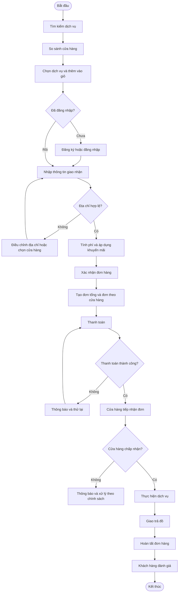

## 1. Các tác nhân tham gia

| Tác nhân | Vai trò | Trách nhiệm chính |
|---|---|---|
| Customer | Khách hàng | Tìm kiếm, so sánh, đặt dịch vụ, thanh toán và đánh giá |
| Seller | Chủ cửa hàng | Quản lý dịch vụ, giá cả và xử lý đơn hàng |
| System | Hệ thống WASHUP | Kiểm tra dữ liệu, tính phí và cập nhật trạng thái |
| Payment Gateway | Cổng thanh toán | Xử lý giao dịch và trả kết quả thanh toán |
| Admin | Quản trị viên | Quản lý tài khoản, cửa hàng, dịch vụ và đơn hàng |

## 2. Quy trình đặt hàng

| Bước | Tác nhân | Hoạt động | Kết quả |
|---|---|---|---|
| 1 | Customer | Tìm kiếm dịch vụ | Danh sách dịch vụ được hiển thị |
| 2 | Customer | So sánh các cửa hàng | Chọn được dịch vụ phù hợp |
| 3 | Customer | Thêm dịch vụ vào giỏ hàng | Giỏ hàng được cập nhật |
| 4 | System | Kiểm tra tài khoản | Xác định trạng thái đăng nhập |
| 5 | System | Kiểm tra khu vực phục vụ | Xác định cửa hàng có thể phục vụ |
| 6 | System | Tính phí và kiểm tra khuyến mãi | Hiển thị tổng chi phí |
| 7 | Customer | Xác nhận đặt hàng | Gửi yêu cầu tạo đơn |
| 8 | System | Tạo đơn hàng tổng và đơn thành phần | Đơn hàng được lưu |
| 9 | Payment Gateway | Xử lý thanh toán | Trả về kết quả giao dịch |
| 10 | Seller | Tiếp nhận và xử lý đơn | Cập nhật tiến độ dịch vụ |
| 11 | Seller | Giao trả đồ | Đơn hàng được hoàn tất |
| 12 | Customer | Đánh giá dịch vụ | Đánh giá được ghi nhận |

## 3. Sơ đồ quy trình đặt hàng

