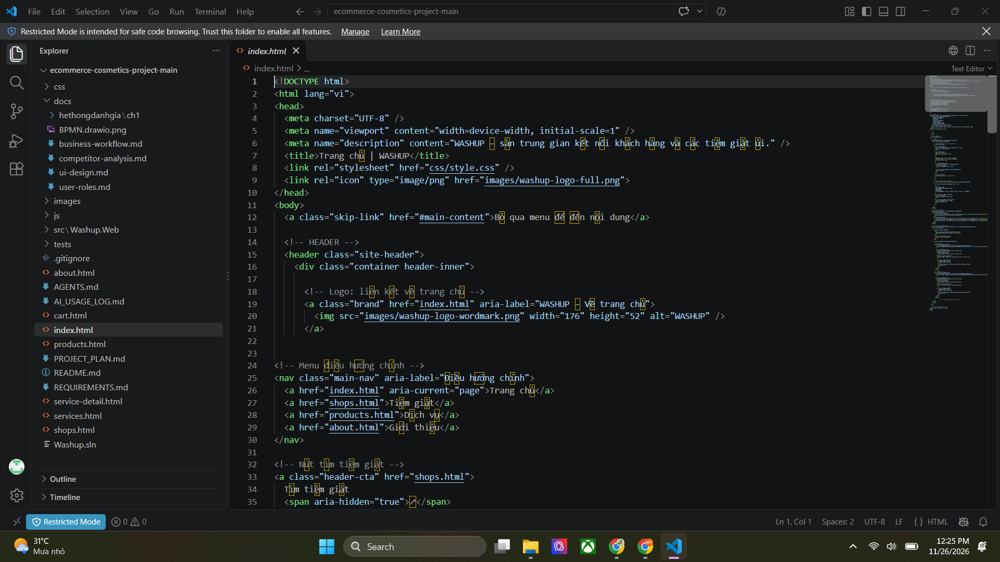
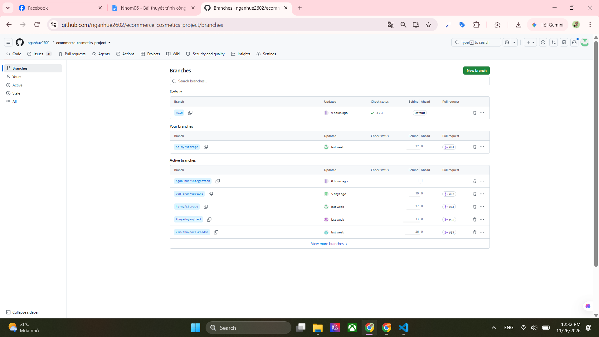
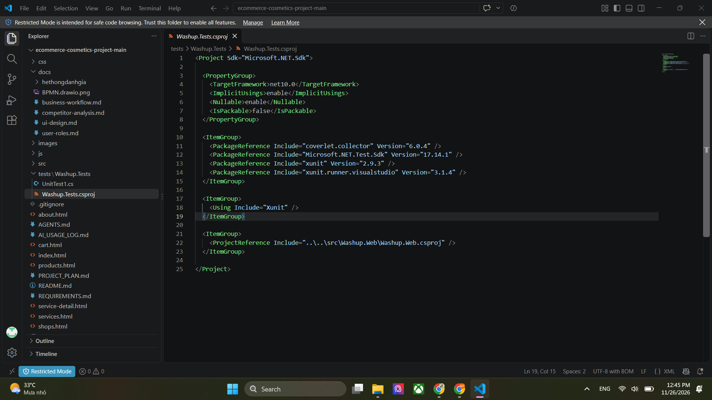

# 2.3. Môi trường và công cụ

## 2.3.1. Môi trường phát triển

Nhóm sử dụng Visual Studio Code làm môi trường lập trình chính để xây dựng, chỉnh sửa và quản lý mã nguồn website WASHUP. Đây là công cụ hỗ trợ làm việc với các ngôn ngữ HTML, CSS, JavaScript và C#, đồng thời cho phép tổ chức mã nguồn theo thư mục, theo dõi lỗi và tích hợp với Git trong quá trình phát triển.

*Hình 2.1. Môi trường lập trình Visual Studio Code*

*Nguồn: Nhóm tác giả*

Dự án được tổ chức thông qua tệp `Washup.sln`, bao gồm project ứng dụng web `Washup.Web` và project kiểm thử `Washup.Tests`. Bên cạnh phiên bản website giao diện được xây dựng bằng HTML, CSS và JavaScript, repository còn có project nền tảng ASP.NET Core MVC sử dụng .NET 10. Cấu trúc này tạo cơ sở để nhóm tiếp tục phát triển và tích hợp các chức năng phía máy chủ trong những giai đoạn tiếp theo.

## 2.3.2. Ngôn ngữ và công nghệ sử dụng

Nhóm sử dụng các ngôn ngữ và công nghệ sau để xây dựng giao diện và triển khai các chức năng của website:

*Bảng 2.1. Các ngôn ngữ và công nghệ sử dụng trong dự án WASHUP*

| Công nghệ | Vai trò trong hệ thống |
|---|---|
| HTML5 | Xây dựng cấu trúc các trang website như trang chủ, danh sách dịch vụ, chi tiết dịch vụ và giỏ hàng. |
| CSS3 | Thiết kế giao diện, định dạng bố cục, màu sắc và các thành phần hiển thị. |
| JavaScript | Xử lý tương tác người dùng, tìm kiếm, lọc, sắp xếp dịch vụ và quản lý giỏ hàng. |
| Bootstrap | Hỗ trợ xây dựng bố cục và các thành phần giao diện website. |
| ASP.NET Core MVC | Nền tảng được sử dụng để tổ chức project ứng dụng web theo mô hình Model – View – Controller. |
| Razor | Công nghệ tạo giao diện phía máy chủ trong project ASP.NET Core MVC. |
| localStorage | Lưu trữ và khôi phục dữ liệu giỏ hàng trực tiếp trên trình duyệt. |

*Nguồn: Nhóm tác giả*

Đối với hệ thống WASHUP hiện tại, HTML5, CSS3 và JavaScript là những công nghệ trực tiếp phục vụ việc xây dựng giao diện và xử lý các chức năng chính. Cụ thể, JavaScript được sử dụng để quản lý dữ liệu dịch vụ, tìm kiếm, lọc, sắp xếp và cập nhật giỏ hàng. Dữ liệu giỏ hàng được lưu bằng `localStorage` nhằm duy trì thông tin sau khi người dùng tải lại trang.

Bên cạnh đó, nhóm đã tổ chức project ASP.NET Core MVC trên nền tảng .NET 10 và sử dụng Razor để chuẩn bị cấu trúc phát triển ứng dụng phía máy chủ. Tuy nhiên, theo README của repository, phiên bản website hiện tại vẫn chưa tích hợp Backend và cơ sở dữ liệu thực tế.

## 2.3.3. Công cụ hỗ trợ phát triển và kiểm thử

Trong quá trình thực hiện, nhóm sử dụng các công cụ hỗ trợ nhằm quản lý mã nguồn, phối hợp làm việc và kiểm tra hoạt động của website.

*Bảng 2.2. Các công cụ hỗ trợ phát triển và kiểm thử WASHUP*

| Công cụ | Mục đích sử dụng |
|---|---|
| Visual Studio Code | Soạn thảo, chỉnh sửa và quản lý các tệp mã nguồn của dự án. |
| Git | Theo dõi lịch sử thay đổi, quản lý nhánh và hỗ trợ tích hợp mã nguồn giữa các thành viên. |
| GitHub | Lưu trữ repository, quản lý các nhánh phát triển, commit và Pull Request. |
| Google Chrome | Truy cập website và kiểm tra giao diện trong quá trình chạy thử. |
| Chrome DevTools | Kiểm tra cấu trúc giao diện, theo dõi hoạt động JavaScript và hỗ trợ phát hiện lỗi. |
| xUnit | Framework được cấu hình trong project kiểm thử Washup.Tests, phục vụ xây dựng các bài kiểm thử cho ứng dụng .NET. |

*Nguồn: Nhóm tác giả*

Trong quá trình phối hợp, nhóm sử dụng Git và GitHub để quản lý các phiên bản mã nguồn. Các thành viên có thể phát triển trên những nhánh riêng, sau đó sử dụng Pull Request để đề xuất tích hợp thay đổi vào nhánh chính. Cách tổ chức này giúp theo dõi tiến độ cập nhật, hạn chế xung đột mã nguồn và hỗ trợ phối hợp giữa các thành viên.

*Hình 2.2. Repository dự án WASHUP trên GitHub*

*Nguồn: Nhóm tác giả*

## 2.3.4. Môi trường triển khai và chạy thử hệ thống

Đối với phiên bản website giao diện, nhóm sử dụng trình duyệt Google Chrome để truy cập và kiểm tra các chức năng như hiển thị danh sách dịch vụ, tìm kiếm, lọc, sắp xếp và quản lý giỏ hàng. Chrome DevTools được sử dụng để theo dõi hoạt động của các thành phần giao diện và hỗ trợ phát hiện lỗi trong quá trình kiểm thử.

Bên cạnh đó, repository đã thiết lập cấu hình chạy cục bộ cho project ASP.NET Core MVC thông qua tệp `launchSettings.json`, với địa chỉ HTTP tại `localhost:5224` và HTTPS tại `localhost:7081`. Các cấu hình này phục vụ quá trình phát triển và kiểm tra ứng dụng trong môi trường cục bộ.

*Hình 2.3. Cấu hình các thư viện kiểm thử trong project Washup.Tests*

*Nguồn: Nhóm tác giả*

Nhìn chung, môi trường và công cụ được lựa chọn đáp ứng nhu cầu xây dựng giao diện, xử lý các chức năng cơ bản, quản lý mã nguồn và kiểm tra hoạt động của website WASHUP. Đây cũng là cơ sở để nhóm tiếp tục mở rộng hệ thống đánh giá và nhận xét dịch vụ trong các giai đoạn phát triển tiếp theo.
