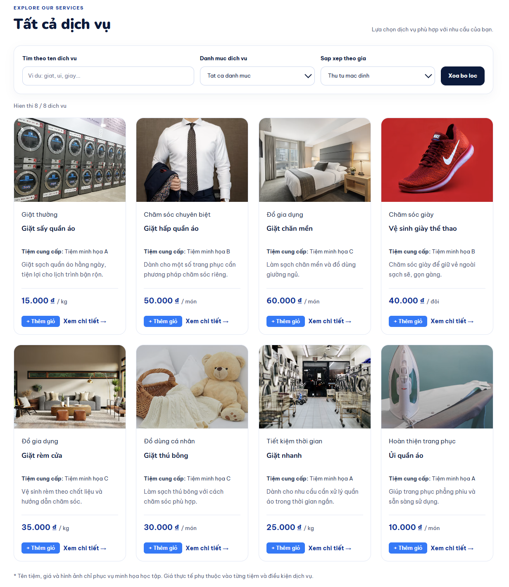
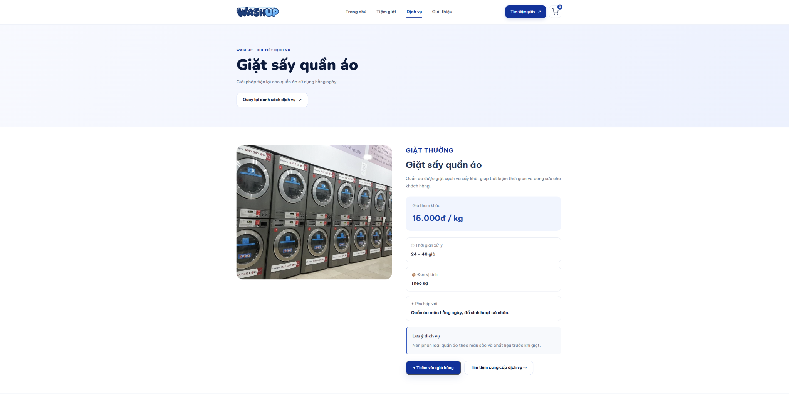
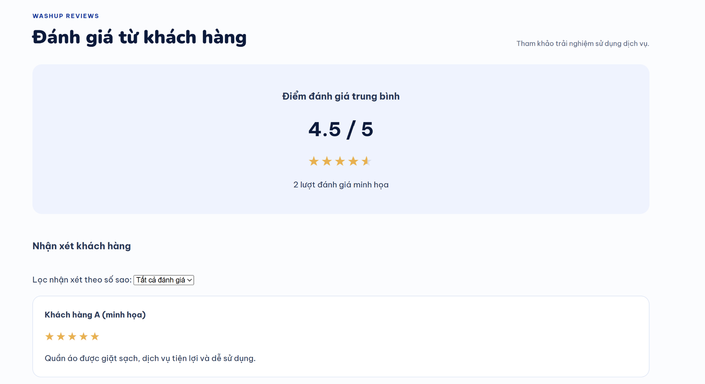
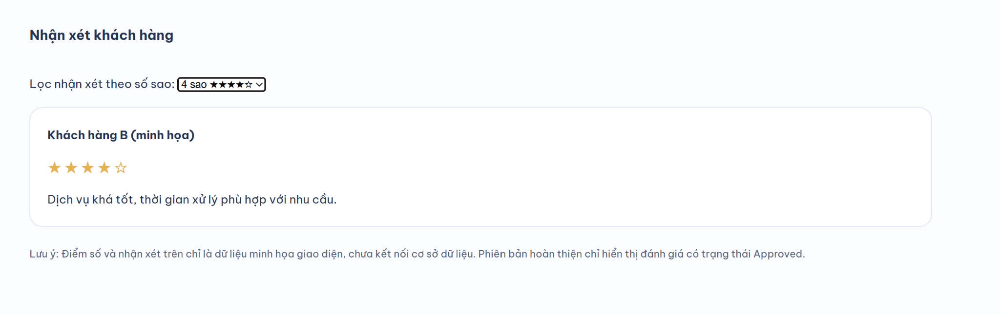
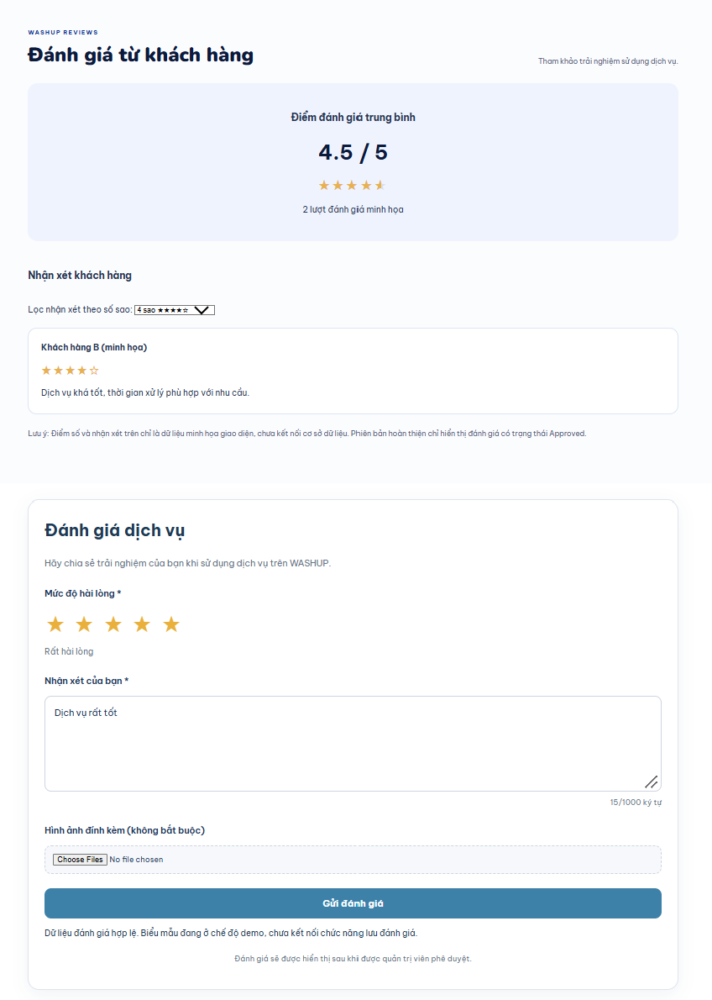

# 2.8. Đưa trang dịch vụ WASHUP vào ứng dụng

## 2.8.1. Cơ sở kế thừa từ website WASHUP

Trong quá trình xây dựng hệ thống đánh giá và nhận xét, nhóm lựa chọn kế thừa các thành phần đã phát triển trên website WASHUP nhằm tận dụng giao diện và dữ liệu dịch vụ có sẵn. WASHUP được xây dựng theo mô hình nền tảng trung gian kết nối khách hàng với nhiều tiệm giặt ủi, qua đó cung cấp cơ sở phù hợp để triển khai hệ thống đánh giá chất lượng dịch vụ.

Ở phiên bản trước, nhóm đã xây dựng trang danh sách dịch vụ (`products.html`) và trang chi tiết dịch vụ (`service-detail.html`). Thông tin của tám dịch vụ được quản lý trong tệp `js/products.js`, bao gồm mã dịch vụ, tên, giá, danh mục, hình ảnh, mô tả và thông tin tiệm cung cấp. Đây là nguồn dữ liệu ban đầu để nhóm xác định mối liên hệ giữa dịch vụ, tiệm giặt và đánh giá của khách hàng.

Việc kế thừa các thành phần này giúp nhóm tập trung phát triển chức năng mới mà không phải xây dựng lại toàn bộ website từ đầu.



**Hình. Giao diện danh sách dịch vụ WASHUP trước khi tích hợp hệ thống đánh giá**

*Nguồn: Nhóm tác giả*

## 2.8.2. Phương án tích hợp trang chi tiết dịch vụ

Trong website WASHUP, khi người dùng nhấn vào một dịch vụ, hệ thống sử dụng mã định danh truyền qua URL để xác định nội dung cần hiển thị. Chẳng hạn, đường dẫn `service-detail.html?id=giat-say` tương ứng với dịch vụ Giặt sấy quần áo.

Đối với ứng dụng mới, nhóm đã chuyển giao diện chi tiết dịch vụ sang Razor View tại tệp `Views/Services/Detail.cshtml` trên nền tảng ASP.NET Core MVC, đồng thời kế thừa cách bố trí thông tin và phong cách thiết kế của WASHUP. Trong phiên bản thử nghiệm, nhóm sử dụng dịch vụ Giặt sấy quần áo thuộc Tiệm minh họa A để kiểm tra khả năng tích hợp giao diện đánh giá. Việc truy xuất dữ liệu theo `ServiceId` và `ShopId` sẽ được hoàn thiện khi kết nối với backend.

Nhóm xác định `ServiceId` là cơ sở liên kết đánh giá với dịch vụ được lựa chọn, trong khi `ShopId` giúp xác định tiệm giặt cung cấp dịch vụ. Việc thống nhất các mã định danh có vai trò quan trọng nhằm tránh tình trạng nhận xét của một dịch vụ được hiển thị nhầm sang dịch vụ hoặc tiệm giặt khác.



**Hình. Giao diện chi tiết dịch vụ Giặt sấy quần áo trên website WASHUP**

*Nguồn: Nhóm tác giả*

## 2.8.3. Bổ sung khu vực đánh giá và nhận xét

Trên cơ sở trang chi tiết dịch vụ đã có, nhóm bổ sung khu vực đánh giá và nhận xét nhằm cung cấp thêm thông tin tham khảo cho khách hàng. Giao diện thử nghiệm hiển thị điểm đánh giá trung bình theo thang năm sao, tổng số lượt đánh giá và danh sách nhận xét minh họa. Các thông tin này được kết hợp với bộ lọc số sao để hỗ trợ khách hàng theo dõi phản hồi về chất lượng dịch vụ.



**Hình. Giao diện hiển thị điểm trung bình và nhận xét khách hàng trên WASHUP**

*Nguồn: Nhóm tác giả*

Bên cạnh đó, người dùng có thể lọc nhận xét theo mức sao để tìm hiểu những phản hồi phù hợp với nhu cầu. Đối với dịch vụ chưa có đánh giá, hệ thống cần hiển thị thông báo rõ ràng thay vì đưa ra điểm số không có cơ sở.

Nhằm bảo đảm tính minh bạch, nhóm xác định chỉ những đánh giá có trạng thái Approved mới được hiển thị công khai và tham gia vào quá trình tính điểm trung bình. Những đánh giá có trạng thái Pending, Rejected hoặc Hidden không được đưa vào kết quả thống kê công khai.



**Hình. Kết quả lọc nhận xét theo mức 4 sao trên WASHUP**

*Nguồn: Nhóm tác giả*

## 2.8.4. Liên kết với các chức năng trong hệ thống

Trong quá trình tích hợp hệ thống đánh giá vào WASHUP, nhóm tiến hành kết hợp giao diện chi tiết dịch vụ với hai chức năng chính gồm hiển thị đánh giá công khai và biểu mẫu gửi đánh giá của khách hàng. Các thành phần được tổ chức trên cùng một trang nhằm tạo ra luồng tương tác thống nhất, giúp người dùng vừa tham khảo nhận xét đã có, vừa thực hiện đánh giá dịch vụ.

Đối với chức năng hiển thị đánh giá, nhóm xây dựng khu vực nhận xét trong tệp `Views/Services/Detail.cshtml`. Giao diện bao gồm điểm trung bình, tổng số lượt đánh giá, danh sách nhận xét và bộ lọc theo mức từ 1 đến 5 sao. JavaScript được sử dụng để kiểm tra trạng thái đánh giá, lọc nhận xét theo số sao và tính toán điểm trung bình từ những đánh giá có trạng thái Approved. Trong dữ liệu thử nghiệm, hệ thống sử dụng hai đánh giá đã duyệt với mức 5 sao và 4 sao, cho kết quả trung bình 4,5/5. Một đánh giá Pending được bổ sung nhằm kiểm tra khả năng loại trừ nhận xét chưa được duyệt khỏi danh sách hiển thị.

Song song đó, nhóm tích hợp biểu mẫu gửi đánh giá được phát triển tại tệp `_ReviewForm.cshtml` vào trang chi tiết dịch vụ thông qua cơ chế Partial View của ASP.NET Core MVC:

```cshtml
@await Html.PartialAsync("_ReviewForm")
```

Biểu mẫu cho phép người dùng lựa chọn mức độ hài lòng từ 1 đến 5 sao, nhập nội dung nhận xét và đính kèm hình ảnh. Phần xử lý trong `review-form.js` hỗ trợ lựa chọn số sao, đếm số ký tự và kiểm tra tính hợp lệ của dữ liệu trước khi gửi. Việc sử dụng Partial View giúp nhóm tái sử dụng giao diện biểu mẫu mà không cần xây dựng lại trong trang chi tiết.

Sau khi ghép hai thành phần, nhóm tiến hành chạy thử ứng dụng trên môi trường localhost. Kết quả kiểm tra cho thấy biểu mẫu được hiển thị cùng khu vực nhận xét, thao tác gửi khi thiếu thông tin xuất hiện thông báo yêu cầu bổ sung dữ liệu và trường hợp nhập hợp lệ được xác nhận ở phía trình duyệt. Đồng thời, chức năng lọc đánh giá theo số sao vẫn hoạt động và điểm trung bình không bị thay đổi khi người dùng lựa chọn bộ lọc. Điều này cho thấy quá trình ghép giao diện không làm ảnh hưởng đến các chức năng JavaScript đã triển khai trước đó.



**Hình. Kết quả tích hợp khu vực hiển thị nhận xét và biểu mẫu gửi đánh giá trên trang chi tiết dịch vụ WASHUP**

*Nguồn: Nhóm tác giả*

Tuy nhiên, kết quả hiện tại mới phản ánh khả năng tích hợp giao diện và xử lý dữ liệu minh họa. Biểu mẫu gửi đánh giá chưa lưu dữ liệu vào cơ sở dữ liệu, trong khi danh sách nhận xét và các chỉ số thống kê vẫn sử dụng dữ liệu mẫu khai báo trong trang Razor. Vì vậy, một đánh giá vừa nhập hợp lệ chưa tự động xuất hiện trong danh sách nhận xét công khai.

Trong giai đoạn hoàn thiện, nhóm sẽ phối hợp các thành phần backend để liên kết đánh giá với đúng `ServiceId`, `ShopId` và thông tin đơn hàng hợp lệ. Dữ liệu đánh giá sau khi gửi cần được lưu và chuyển qua quy trình kiểm duyệt. Chỉ những đánh giá đã được chấp thuận mới được trả về trang công khai để hiển thị và tính điểm trung bình. Việc phân chia rõ trách nhiệm giữa biểu mẫu, xử lý nghiệp vụ, kiểm duyệt và giao diện thống kê giúp hạn chế mã nguồn trùng lặp, đồng thời tạo điều kiện thuận lợi cho việc kiểm thử và mở rộng hệ thống.

## 2.8.5. Kiểm tra và đánh giá phương án tích hợp

Để đánh giá kết quả tích hợp, nhóm xác định các tiêu chí kiểm thử gồm khả năng hiển thị đúng thông tin dịch vụ, liên kết chính xác giữa `ServiceId` và `ShopId`, hiển thị đánh giá đã được duyệt, tính toán điểm trung bình và cập nhật danh sách khi người dùng thay đổi bộ lọc.

Ngoài ra, giao diện cần được kiểm tra trên máy tính, máy tính bảng và điện thoại nhằm bảo đảm nội dung không bị chồng lấn hoặc tràn khỏi màn hình.

Trong phạm vi bản demo hiện tại, nhóm đã kiểm tra khả năng hiển thị thông tin của dịch vụ minh họa, lọc nhận xét theo số sao, tính điểm trung bình và tích hợp biểu mẫu đánh giá. Các kết quả kiểm tra chức năng được trình bày cụ thể tại mục 3.6 và 3.7.

Việc truy xuất thông tin dịch vụ từ cơ sở dữ liệu, xác minh điều kiện gửi đánh giá và kiểm soát trạng thái kiểm duyệt ở phía máy chủ vẫn cần được hoàn thiện khi tích hợp với các phân hệ backend.

Kết quả triển khai cuối cùng sẽ được đối chiếu thông qua mã nguồn, dữ liệu thực tế, ảnh giao diện và các trường hợp kiểm thử của hệ thống.
