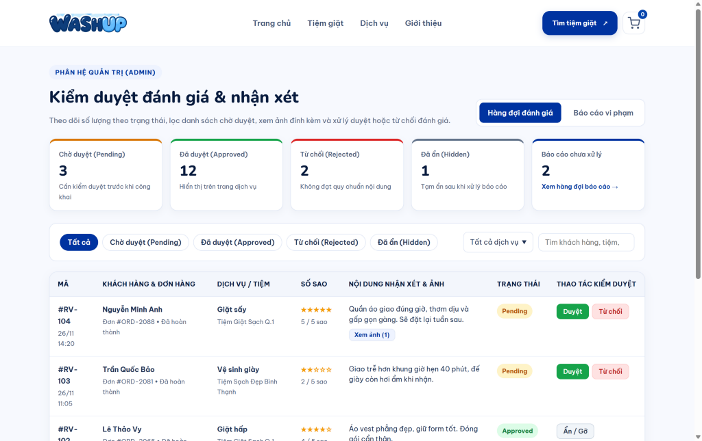
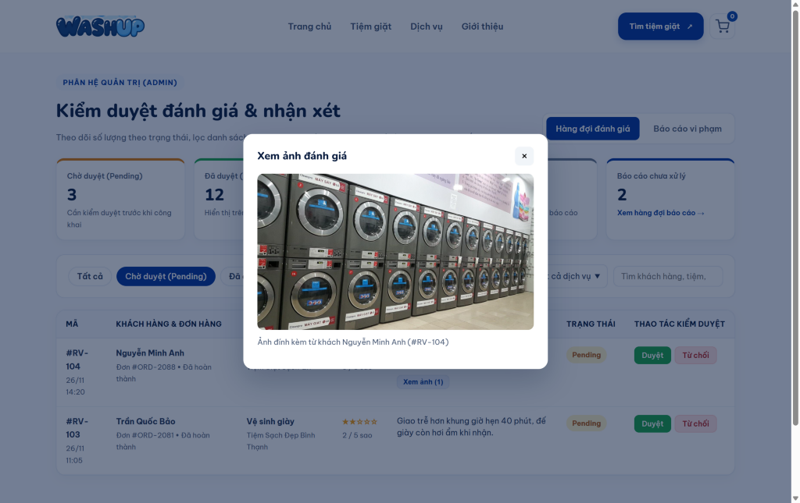
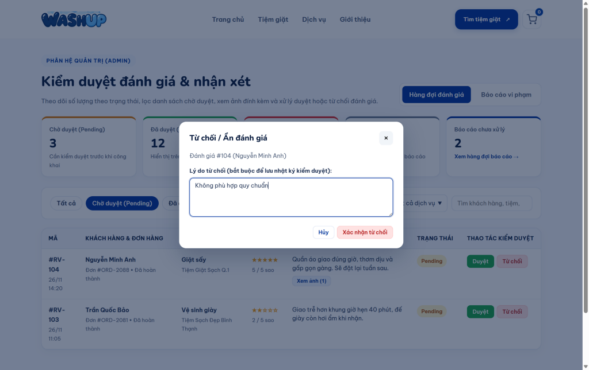

# 3.4. Màn hình quản lý đánh giá

## 3.4.1. Mục tiêu và vị trí trong hệ thống

Màn hình quản lý đánh giá (`Views/AdminReviews/Index.cshtml`) thuộc phân hệ Quản trị viên (Admin), giúp người quản trị rà soát toàn bộ nhận xét do khách hàng gửi lên trước khi công khai trên trang chi tiết dịch vụ. Giao diện được xây dựng trên nền tảng ASP.NET Core MVC (`src/Washup.Web`), kế thừa bố cục chung (`_Layout.cshtml`) và bảng màu chuẩn của WASHUP (`--navy: #071a3d`, `--imperial: #0033a0`, `--pale: #eef3ff`).

> **Lưu ý về phân quyền:** Giao diện Razor chỉ đảm nhận hiển thị danh sách, lọc trên bảng và gửi biểu mẫu kèm `@Html.AntiForgeryToken()`. Việc xác thực vai trò Admin (`[Authorize(Roles = "Admin")]`) và ghi nhận thay đổi trạng thái vào cơ sở dữ liệu được thực hiện hoàn toàn ở phía máy chủ thông qua `AdminReviewsController` (không xử lý phân quyền phía client-side).

## 3.4.2. Cấu trúc màn hình hàng đợi kiểm duyệt

Giao diện `Views/AdminReviews/Index.cshtml` kết hợp cùng `wwwroot/css/admin-reviews.css` và `wwwroot/js/admin-reviews.js` gồm 4 khu vực chính như minh họa ở Hình 3.1:

1. **Thanh tiêu đề và điều hướng phân hệ:** Hiển thị tên trang *"Kiểm duyệt đánh giá & nhận xét"* cùng hai tab chuyển đổi nhanh giữa **Hàng đợi đánh giá** (`/AdminReviews/Index`) và **Báo cáo vi phạm** (`/AdminReviews/Reports`).
2. **Dãy thẻ KPI trạng thái (`_StatusKpiCards.cshtml`):** Thống kê nhanh số lượng đánh giá theo 4 trạng thái (`Pending`, `Approved`, `Rejected`, `Hidden`) và số lượng báo cáo chưa xử lý.
3. **Thanh công cụ lọc và tìm kiếm:**
   - Nhóm nút lọc trạng thái: `Tất cả`, `Chờ duyệt (Pending)`, `Đã duyệt (Approved)`, `Từ chối (Rejected)`, `Đã ẩn (Hidden)`.
   - Bộ lọc theo mã dịch vụ (`giat-say`, `giat-hap`, `ve-sinh-giay`, `giat-nhanh`) và ô tìm kiếm nhanh theo tên khách hàng, tên tiệm hoặc nội dung nhận xét.
4. **Bảng danh sách đánh giá:** Trình bày các cột: *Mã & thời gian gửi*, *Khách hàng & mã đơn hàng*, *Dịch vụ / Tiệm*, *Số sao*, *Nội dung nhận xét & Ảnh*, *Trạng thái* và *Thao tác kiểm duyệt*.

*Hình 3.1. Giao diện màn hình hàng đợi kiểm duyệt đánh giá (`/AdminReviews/Index`) chạy trên môi trường phát triển.*

## 3.4.3. Xem ảnh đính kèm và thao tác Duyệt / Từ chối

Đối với các đánh giá có hình ảnh đính kèm (ví dụ `#RV-104`), hệ thống hiển thị nút **Xem ảnh (1)** ngay dưới nội dung nhận xét. Khi quản trị viên nhấn vào nút này, hộp thoại xem trước (`#image-preview-modal`) sẽ mở ra để kiểm tra tính hợp lệ của hình ảnh trước khi ra quyết định (Hình 3.2).

*Hình 3.2. Bộ lọc trạng thái `Chờ duyệt (Pending)` kết hợp hộp thoại xem trước ảnh đính kèm trên đánh giá `#RV-104`.*

Ở cột **Thao tác kiểm duyệt**, mỗi dòng ở trạng thái `Pending` có hai nút chức năng rõ ràng:

- **Nút Duyệt (`POST /AdminReviews/Approve`):** Gửi `reviewId` lên máy chủ để chuyển trạng thái sang `Approved` và cho phép hiển thị công khai trên trang dịch vụ.
- **Nút Từ chối (`Từ chối` / `Ẩn / Gỡ`):** Mở hộp thoại `#reject-reason-modal` (Hình 3.3) yêu cầu quản trị viên nhập lý do từ chối trước khi gửi `POST /AdminReviews/Reject`. Việc bắt buộc nhập lý do giúp lưu vết kiểm duyệt (audit) minh bạch trong cơ sở dữ liệu.

*Hình 3.3. Hộp thoại nhập lý do từ chối đánh giá `#RV-104` trước khi gửi về máy chủ.*

Bảng 3.1 tóm tắt các thành phần mã nguồn phục vụ màn hình quản lý đánh giá:

| Tệp mã nguồn | Vai trò |
|---|---|
| `src/Washup.Web/Views/AdminReviews/Index.cshtml` | Khung trang hàng đợi kiểm duyệt, bảng đánh giá, modal xem ảnh và modal từ chối |
| `src/Washup.Web/Views/AdminReviews/_StatusKpiCards.cshtml` | Partial hiển thị 5 thẻ KPI theo dõi trạng thái |
| `src/Washup.Web/wwwroot/css/admin-reviews.css` | Định kiểu giao diện quản trị đồng bộ bảng màu WASHUP |
| `src/Washup.Web/wwwroot/js/admin-reviews.js` | Xử lý lọc giao diện, tìm kiếm tức thời và đóng/mở hộp thoại |

*Bảng 3.1. Danh sách tệp giao diện màn hình quản lý đánh giá.*
