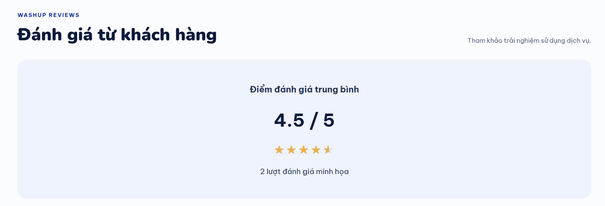
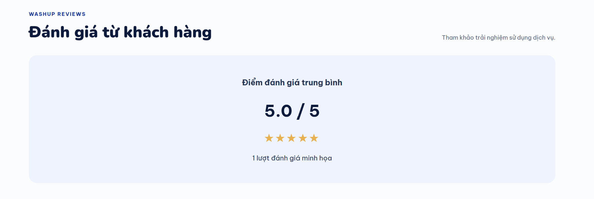
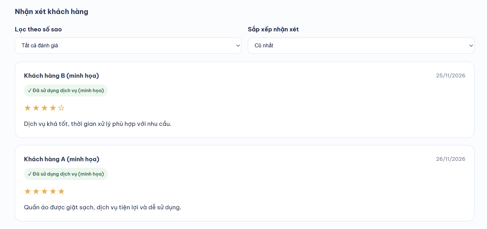
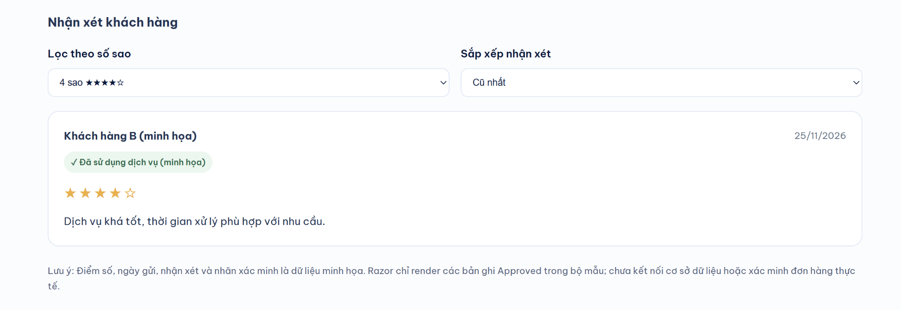
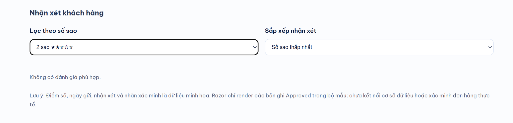
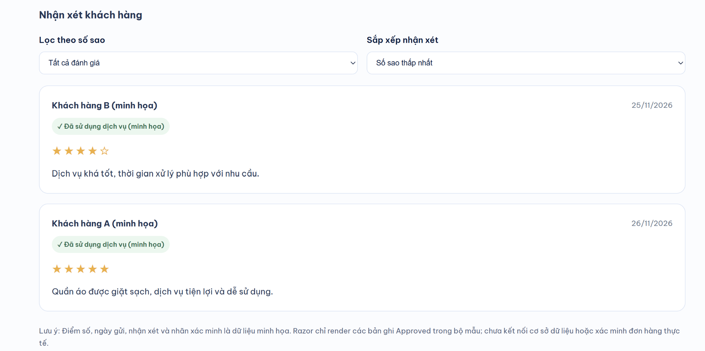

## 3.7. Tính điểm trung bình, lọc và sắp xếp đánh giá

### 3.7.1. Mục tiêu thực hiện

Bên cạnh chức năng hiển thị danh sách nhận xét, nhóm phát triển chức năng tính điểm đánh giá trung bình, lọc và sắp xếp nhận xét nhằm giúp khách hàng thuận tiện tham khảo và so sánh chất lượng dịch vụ trên nền tảng WASHUP.

Nhóm xác định nguyên tắc chỉ sử dụng những đánh giá có trạng thái Approved để hiển thị công khai và tính điểm trung bình. Những đánh giá có trạng thái Pending, Rejected hoặc Hidden không được đưa vào kết quả thống kê chất lượng dịch vụ.

Đồng thời, nhóm xây dựng bộ lọc từ 1 đến 5 sao và chức năng sắp xếp theo thời gian gửi hoặc mức sao. Các thao tác này được xử lý trực tiếp trên giao diện mà không cần tải lại toàn bộ trang, giúp nâng cao tính thuận tiện trong quá trình sử dụng.

### 3.7.2. Phương án tính điểm đánh giá trung bình

#### 3.7.2.1. Nguyên tắc tính điểm đánh giá trung bình

Trong phiên bản thử nghiệm ban đầu, nhóm sử dụng JavaScript để tính điểm trung bình từ các thẻ nhận xét được khai báo trong trang Razor. Mỗi nhận xét được gắn thuộc tính `data-rating` để xác định số sao và `data-status` để xác định trạng thái kiểm duyệt.

Ở phiên bản cải tiến, nhóm tổ chức danh sách nhận xét thông qua Partial View `_ReviewList.cshtml` và thực hiện lựa chọn các đánh giá có trạng thái Approved tại Razor View trước khi tạo nội dung HTML. Cách xử lý này giúp loại trừ những nhận xét chưa được duyệt khỏi danh sách trả về trình duyệt.

Điểm trung bình ban đầu được xác định tại Razor View. Sau khi giao diện được tải, JavaScript tiếp tục hỗ trợ cập nhật điểm đánh giá, số lượt đánh giá và tỷ lệ hiển thị sao tương ứng.

Điểm đánh giá trung bình được xác định theo công thức:

**Điểm trung bình = Tổng số sao của các đánh giá Approved / Số lượng đánh giá Approved**

Trường hợp không có đánh giá Approved, hệ thống cần hiển thị thông báo phù hợp, xác định tổng số lượt đánh giá bằng 0 và không thực hiện phép chia cho 0.

#### 3.7.2.2. Áp dụng công thức với dữ liệu minh họa

Để kiểm tra khả năng tính toán, nhóm sử dụng ba bản ghi đánh giá minh họa có mức sao và trạng thái kiểm duyệt khác nhau.

**Bảng. Dữ liệu minh họa phục vụ kiểm thử chức năng tính điểm trung bình**

| Khách hàng | Số sao | Trạng thái | Tính vào điểm trung bình |
|---|---:|---|---|
| Khách hàng A | 5 | Approved | Có |
| Khách hàng B | 4 | Approved | Có |
| Khách hàng C | 2 | Pending | Không |

*Nguồn: Nhóm tác giả*

Trong bộ dữ liệu trên, chỉ hai đánh giá của khách hàng A và B đáp ứng điều kiện Approved. Đánh giá của khách hàng C không được đưa vào kết quả tính toán do đang chờ kiểm duyệt.

Điểm trung bình của dịch vụ được xác định như sau:

**(5 + 4) / 2 = 4,5/5**

Kết quả được thể hiện thông qua điểm số 4,5/5, tổng cộng hai lượt đánh giá và biểu tượng tương ứng bốn sao rưỡi.

Điểm trung bình được xác định dựa trên toàn bộ đánh giá đã được duyệt, không phụ thuộc vào bộ lọc số sao hoặc thứ tự sắp xếp nhận xét mà người dùng lựa chọn.

### 3.7.3. Tích hợp chức năng lọc và sắp xếp đánh giá

#### 3.7.3.1. Tổ chức các thành phần mã nguồn

Nhằm hỗ trợ khách hàng tra cứu nhận xét phù hợp với nhu cầu, nhóm bổ sung bộ lọc theo số sao và chức năng sắp xếp đánh giá trên trang chi tiết dịch vụ WASHUP.

Danh sách nhận xét được tổ chức thông qua Partial View `_ReviewList.cshtml`, kết hợp với tệp `review-list.js` để xử lý tương tác và tệp `review-list.css` để định dạng giao diện. Việc tách riêng các thành phần giúp mã nguồn dễ quản lý, bảo trì và mở rộng.

**Bảng. Các tệp mã nguồn phục vụ chức năng lọc và sắp xếp đánh giá**

| Tệp mã nguồn | Vai trò |
|---|---|
| `Views/Services/Detail.cshtml` | Tổ chức trang chi tiết dịch vụ và tích hợp các thành phần đánh giá |
| `Views/Shared/_ReviewList.cshtml` | Hiển thị danh sách nhận xét, bộ lọc và lựa chọn sắp xếp |
| `wwwroot/js/review-list.js` | Xử lý tính điểm, lọc và sắp xếp nhận xét |
| `wwwroot/css/review-list.css` | Định dạng giao diện và hỗ trợ responsive |

*Nguồn: Nhóm tác giả*

Cách tổ chức này giúp hạn chế việc khai báo toàn bộ giao diện, định dạng và logic xử lý trong cùng một tệp Razor View, đồng thời tạo điều kiện thuận lợi cho việc tích hợp dữ liệu trong giai đoạn tiếp theo.

#### 3.7.3.2. Xây dựng chức năng lọc theo số sao

Bộ lọc cho phép người dùng lựa chọn tất cả đánh giá hoặc từng mức từ 1 đến 5 sao. Khi người dùng thay đổi lựa chọn, JavaScript đối chiếu mức sao được chọn với thông tin số sao của từng nhận xét và cập nhật danh sách hiển thị.

Những đánh giá không phù hợp với điều kiện lọc được ẩn khỏi giao diện. Trong trường hợp không có nhận xét đáp ứng điều kiện, hệ thống hiển thị thông báo “Không có đánh giá phù hợp”.

Việc sử dụng bộ lọc không làm thay đổi điểm đánh giá trung bình chung của dịch vụ, do chỉ số này được xác định dựa trên toàn bộ đánh giá Approved thay vì chỉ những nhận xét đang hiển thị.

#### 3.7.3.3. Xây dựng chức năng sắp xếp nhận xét

Bên cạnh bộ lọc số sao, nhóm bổ sung chức năng sắp xếp nhận xét theo thời gian gửi và mức độ đánh giá. Chức năng này giúp khách hàng chủ động lựa chọn thứ tự tham khảo phản hồi phù hợp với nhu cầu.

**Bảng. Các lựa chọn lọc và sắp xếp đánh giá trên WASHUP**

| Chức năng | Nội dung xử lý |
|---|---|
| Tất cả đánh giá | Hiển thị toàn bộ nhận xét Approved trong bộ dữ liệu mẫu |
| Lọc từ 1–5 sao | Hiển thị nhận xét có mức sao tương ứng |
| Mới nhất | Sắp xếp theo thời gian gửi giảm dần |
| Cũ nhất | Sắp xếp theo thời gian gửi tăng dần |
| Sao cao nhất | Sắp xếp theo số sao giảm dần |
| Sao thấp nhất | Sắp xếp theo số sao tăng dần |

*Nguồn: Nhóm tác giả*

Các thao tác lọc và sắp xếp được xử lý bằng JavaScript mà không cần tải lại toàn bộ trang. Người dùng có thể kết hợp hai chức năng để xác định phạm vi nhận xét và thứ tự hiển thị mong muốn.

Thông tin thời gian gửi đánh giá hiện được khai báo trong bộ dữ liệu minh họa nhằm kiểm tra khả năng sắp xếp, chưa được truy xuất trực tiếp từ cơ sở dữ liệu.

### 3.7.4. Kiểm thử chức năng

Sau khi hoàn thiện chức năng tính điểm trung bình, lọc và sắp xếp nhận xét, nhóm tiến hành kiểm thử ứng dụng ASP.NET Core MVC trên môi trường localhost.

Quá trình kiểm thử tập trung vào tính chính xác của kết quả tính toán, khả năng cập nhật danh sách nhận xét và sự phối hợp giữa các chức năng khi người dùng thực hiện thao tác trên giao diện.

#### 3.7.4.1. Kiểm thử chức năng tính điểm trung bình

Trong bộ dữ liệu thử nghiệm, hệ thống ghi nhận hai đánh giá có trạng thái Approved với số sao lần lượt là 5 và 4.

Điểm trung bình = (5 + 4) / 2 = 4,5/5.

Giao diện hiển thị điểm trung bình 4,5/5, tổng cộng hai lượt đánh giá và biểu tượng tương ứng bốn sao rưỡi.

**Hình. Kết quả tính điểm trung bình từ hai đánh giá đã được duyệt**

*Nguồn: Nhóm tác giả*

Để xác minh khả năng tính toán tự động, trong phiên bản thử nghiệm ban đầu, nhóm thay đổi tạm thời trạng thái của đánh giá 4 sao từ Approved sang Pending. Sau khi tải lại trang, hệ thống chỉ còn một đánh giá được duyệt với mức 5 sao.

Điểm trung bình tự động chuyển từ 4,5/5 sang 5,0/5, đồng thời số lượt đánh giá giảm từ hai xuống một.

**Hình. Kết quả cập nhật điểm trung bình khi thay đổi trạng thái kiểm duyệt của đánh giá**

*Nguồn: Nhóm tác giả*

Kết quả kiểm thử phiên bản ban đầu cho thấy chức năng tính điểm trung bình phản hồi phù hợp với sự thay đổi của số lượng đánh giá Approved. Sau khi kiểm thử, nhóm khôi phục trạng thái ban đầu để duy trì bộ dữ liệu minh họa thống nhất.

Trong phiên bản cải tiến, nhóm thực hiện lựa chọn các đánh giá Approved tại Razor View trước khi tạo nội dung HTML, giúp loại trừ những bản ghi chưa được duyệt khỏi danh sách nhận xét trả về trình duyệt.

#### 3.7.4.2. Kiểm thử chức năng sắp xếp theo thời gian gửi

Để kiểm tra khả năng sắp xếp nhận xét theo thời gian, nhóm sử dụng hai đánh giá minh họa có ngày gửi khác nhau, trong đó nhận xét của khách hàng A được gửi sau nhận xét của khách hàng B.

Ở chế độ Mới nhất, nhận xét của khách hàng A được hiển thị trước nhận xét của khách hàng B. Khi chuyển sang chế độ Cũ nhất, thứ tự mong đợi của danh sách được đảo ngược, trong đó nhận xét của khách hàng B xuất hiện trước khách hàng A.

**Hình. Kiểm thử chức năng sắp xếp nhận xét theo thời gian gửi tăng dần trên WASHUP**

*Nguồn: Nhóm tác giả*

Chức năng sắp xếp theo thời gian giúp khách hàng chủ động lựa chọn thứ tự tham khảo nhận xét, đồng thời hỗ trợ việc theo dõi những phản hồi mới về chất lượng dịch vụ.

#### 3.7.4.3. Kiểm thử chức năng lọc theo số sao

Nhóm thực hiện kiểm thử bộ lọc bằng cách lựa chọn mức đánh giá 4 sao trên trang chi tiết dịch vụ.

Trong bộ dữ liệu minh họa, khách hàng B là người duy nhất có đánh giá 4 sao và trạng thái Approved. Do đó, kết quả mong đợi là danh sách chỉ hiển thị nhận xét của khách hàng B, trong khi nhận xét 5 sao của khách hàng A được ẩn khỏi giao diện.

**Hình. Kiểm thử chức năng lọc nhận xét theo mức 4 sao trên WASHUP**

*Nguồn: Nhóm tác giả*

Việc thay đổi bộ lọc chỉ tác động đến danh sách nhận xét đang hiển thị, không làm thay đổi điểm trung bình chung và tổng số đánh giá đã được duyệt của dịch vụ.

#### 3.7.4.4. Kiểm thử trường hợp không có đánh giá phù hợp

Bên cạnh các trường hợp có kết quả, nhóm kiểm tra khả năng xử lý khi người dùng lựa chọn mức sao không có nhận xét phù hợp.

Trong bộ dữ liệu thử nghiệm, khách hàng C có đánh giá 2 sao nhưng đang ở trạng thái Pending. Bản ghi này không được đưa vào danh sách nhận xét công khai do chưa đáp ứng điều kiện kiểm duyệt.

Khi lựa chọn bộ lọc 2 sao, kết quả mong đợi là giao diện không hiển thị thẻ nhận xét nào và xuất hiện thông báo “Không có đánh giá phù hợp”.

**Hình. Kiểm thử trường hợp không có nhận xét phù hợp với điều kiện lọc**

*Nguồn: Nhóm tác giả*

Việc bổ sung thông báo giúp người dùng nhận biết nguyên nhân danh sách không có kết quả, tránh nhầm lẫn với tình trạng lỗi hoặc không tải được dữ liệu.

#### 3.7.4.5. Kiểm thử chức năng sắp xếp theo số sao

Ngoài chức năng sắp xếp theo thời gian, nhóm bổ sung khả năng sắp xếp nhận xét theo mức sao tăng dần hoặc giảm dần nhằm hỗ trợ khách hàng tham khảo phản hồi theo nhu cầu.

Để kiểm tra chức năng này, nhóm đưa bộ lọc về chế độ Tất cả đánh giá và lựa chọn chế độ Sao thấp nhất.

Theo bộ dữ liệu thử nghiệm, khách hàng B có đánh giá 4 sao, trong khi khách hàng A có đánh giá 5 sao. Vì vậy, kết quả mong đợi là nhận xét của khách hàng B được hiển thị trước nhận xét của khách hàng A.

**Hình. Kiểm thử chức năng sắp xếp nhận xét theo số sao tăng dần trên WASHUP**

*Nguồn: Nhóm tác giả*

Chức năng này giúp khách hàng thuận tiện tham khảo cả những phản hồi tích cực và những nhận xét có mức độ hài lòng thấp hơn trước khi quyết định sử dụng dịch vụ.

#### 3.7.4.6. Tổng hợp các trường hợp kiểm thử

Để đánh giá khả năng đáp ứng yêu cầu chức năng, nhóm xây dựng bảng tổng hợp các trường hợp kiểm thử đối với chức năng tính điểm trung bình, lọc và sắp xếp nhận xét.

**Bảng. Tổng hợp các trường hợp kiểm thử chức năng tính điểm trung bình, lọc và sắp xếp đánh giá**

| Mã kiểm thử | Nội dung kiểm thử | Kết quả mong đợi |
|---|---|---|
| RV01 | Tính điểm từ hai đánh giá Approved | Hiển thị 4,5/5 và hai lượt đánh giá |
| RV02 | Thay đổi trạng thái đánh giá 4 sao trong phiên bản ban đầu | Hiển thị 5,0/5 và một lượt đánh giá |
| RV03 | Sắp xếp mới nhất | Khách hàng A đứng trước B |
| RV04 | Sắp xếp cũ nhất | Khách hàng B đứng trước A |
| RV05 | Lọc đánh giá 4 sao | Chỉ hiển thị khách hàng B |
| RV06 | Lọc đánh giá 5 sao | Chỉ hiển thị khách hàng A |
| RV07 | Lọc đánh giá 2 sao | Hiển thị thông báo không có đánh giá phù hợp |
| RV08 | Sắp xếp sao thấp nhất | Khách hàng B đứng trước A |
| RV09 | Sắp xếp sao cao nhất | Khách hàng A đứng trước B |
| RV10 | Thay đổi bộ lọc và thứ tự sắp xếp | Điểm trung bình chung vẫn giữ ở mức 4,5/5 |

*Nguồn: Nhóm tác giả*

Các trường hợp kiểm thử trên được sử dụng để đối chiếu khả năng hoạt động của từng chức năng cũng như sự phối hợp giữa các thành phần trên giao diện. Trong đó, điểm trung bình được xác định dựa trên toàn bộ đánh giá Approved, còn bộ lọc và chức năng sắp xếp chỉ điều chỉnh danh sách nhận xét hiển thị.

Phạm vi kiểm thử hiện tại sử dụng dữ liệu minh họa, chưa bao gồm việc truy xuất đánh giá từ cơ sở dữ liệu, xác minh đơn hàng thực tế và cập nhật dữ liệu sau khi quản trị viên thực hiện kiểm duyệt.

### 3.7.5. Kết quả thực hiện và giới hạn

#### 3.7.5.1. Kết quả thực hiện

Qua quá trình triển khai, nhóm đã xây dựng giao diện tính điểm đánh giá trung bình, lọc nhận xét theo số sao và sắp xếp nhận xét trên trang chi tiết dịch vụ WASHUP.

So với phiên bản ban đầu, nhóm bổ sung chức năng sắp xếp theo thời gian gửi và mức sao, đồng thời hoàn thiện thông tin trên từng thẻ nhận xét thông qua ngày đánh giá và nhãn xác minh khách hàng đã sử dụng dịch vụ.

Về mặt kỹ thuật, nhóm tổ chức danh sách nhận xét thông qua Partial View `_ReviewList.cshtml`, kết hợp tệp `review-list.js` để xử lý tương tác và tệp `review-list.css` để định dạng giao diện. Việc phân chia các thành phần giúp mã nguồn dễ quản lý, bảo trì và mở rộng.

Một cải tiến quan trọng là việc lựa chọn các đánh giá Approved được thực hiện tại Razor View trước khi tạo nội dung HTML, thay cho phương án chỉ ẩn nhận xét chưa được duyệt bằng JavaScript. Kết quả kiểm tra bằng Chrome DevTools cho thấy danh sách DOM chỉ chứa hai đánh giá Approved của khách hàng A và B trong bộ dữ liệu thử nghiệm.

Các chức năng lọc và sắp xếp được thiết kế để hoạt động độc lập với điểm trung bình chung của dịch vụ. Điều này giúp người dùng lựa chọn cách xem nhận xét phù hợp mà không làm thay đổi chỉ số thống kê chất lượng dịch vụ.

#### 3.7.5.2. Hạn chế và hướng hoàn thiện

Phiên bản hiện tại vẫn sử dụng dữ liệu minh họa, chưa kết nối với cơ sở dữ liệu thực tế. Thông tin ngày đánh giá và nhãn xác minh khách hàng cũng chưa được truy xuất hoặc xác thực thông qua dữ liệu đơn hàng.

Trong giai đoạn tích hợp tiếp theo, nhóm cần kết nối danh sách nhận xét với backend nhằm bảo đảm dữ liệu được truy xuất theo đúng dịch vụ, tiệm giặt và trạng thái kiểm duyệt.

Sau khi tích hợp, các chức năng hiển thị, tính điểm trung bình, lọc và sắp xếp cần được kiểm thử lại với dữ liệu thực tế, đặc biệt trong những trường hợp dịch vụ chưa có đánh giá, có nhiều đánh giá hoặc trạng thái kiểm duyệt thay đổi.

Nhìn chung, kết quả thực hiện đã tạo nền tảng cho việc hoàn thiện chức năng hiển thị và tra cứu đánh giá trên WASHUP, góp phần nâng cao tính minh bạch của thông tin và hỗ trợ khách hàng trong quá trình lựa chọn dịch vụ.
