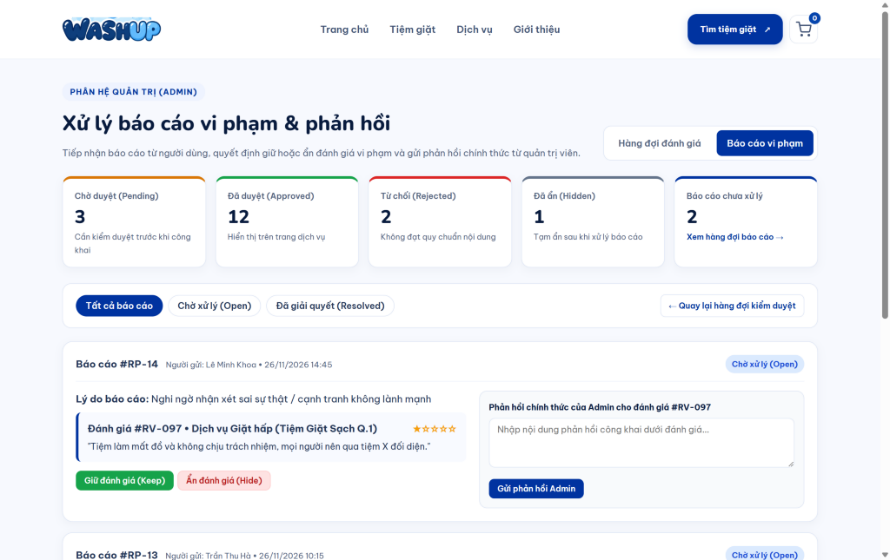

# 4.3.3. Giao diện xử lý báo cáo vi phạm và phản hồi

## 4.3.3.1. Bố cục trang Báo cáo vi phạm

Trang xử lý báo cáo vi phạm (`Views/AdminReviews/Reports.cshtml`) được thiết kế để quản trị viên tiếp nhận các phản ánh từ người dùng đối với những đánh giá đã công khai (ví dụ: nội dung quảng cáo, ngôn từ thiếu chuẩn mực, hoặc hình ảnh không liên quan đến dịch vụ giặt ủi).

Giao diện kế thừa partial KPI (`_StatusKpiCards.cshtml`) ở phần đầu trang nhằm giúp quản trị viên nắm bắt ngay số lượng báo cáo đang chờ xử lý, đồng thời cung cấp thanh lọc nhanh theo 3 trạng thái:

- **Tất cả báo cáo** (`All`)
- **Chờ xử lý (`Open`)**
- **Đã giải quyết (`Resolved`)**

*Hình 4.1. Giao diện trang xử lý báo cáo vi phạm (`/AdminReviews/Reports`) với danh sách thẻ báo cáo và khung phản hồi.*

## 4.3.3.2. Chi tiết thẻ báo cáo, nút giải quyết và biểu mẫu phản hồi

Mỗi báo cáo vi phạm được trình bày dưới dạng thẻ độc lập (`.report-card`) gồm 2 cột thông tin như thể hiện ở Hình 4.1:

1. **Cột trái — Thông tin vi phạm và quyết định xử lý:**
   - Hiển thị mã báo cáo (`#RP-14`, `#RP-13`, `#RP-11`), tên người gửi báo cáo, thời gian gửi và huy hiệu trạng thái (`Chờ xử lý (Open)` hoặc `Đã ẩn đánh giá (Resolved)`).
   - Nêu rõ **Lý do báo cáo** và trích dẫn nguyên văn **nội dung đánh giá bị báo cáo** (kèm mã đánh giá, tên dịch vụ, tên tiệm và số sao).
   - Cung cấp 2 nút hành động gửi biểu mẫu `POST /AdminReviews/ResolveReport`:
     - **Giữ đánh giá (`Keep`):** Xác nhận nội dung hợp lệ và giữ nguyên hiển thị công khai.
     - **Ẩn đánh giá (`Hide`):** Chuyển đánh giá sang trạng thái `Hidden` để ngừng hiển thị trên trang dịch vụ và loại khỏi tính toán thống kê.
2. **Cột phải — Khung phản hồi chính thức của Admin:**
   - Chứa biểu mẫu `POST /AdminReviews/Reply` với ô nhập nội dung phản hồi (`replyContent`) và nút **Gửi phản hồi Admin** gắn theo `reviewId`.
   - Đối với báo cáo đã giải quyết (như `#RP-11`), khung này hiển thị lại nội dung phản hồi đã lưu của quản trị viên để tiện tra cứu.

Bảng 4.1 mô tả các hành động trên giao diện xử lý báo cáo:

| Thành phần giao diện | Phương thức & Đích gửi | Kết quả nghiệp vụ dự kiến |
|---|---|---|
| Nút `Giữ đánh giá (Keep)` | `POST /AdminReviews/ResolveReport` (`decision=Keep`) | Đóng báo cáo (`Resolved`), giữ đánh giá ở trạng thái `Approved` |
| Nút `Ẩn đánh giá (Hide)` | `POST /AdminReviews/ResolveReport` (`decision=Hide`) | Đóng báo cáo (`Resolved`), chuyển đánh giá sang trạng thái `Hidden` |
| Biểu mẫu `Gửi phản hồi Admin` | `POST /AdminReviews/Reply` (`reviewId`, `replyContent`) | Lưu phản hồi chính thức của quản trị viên dưới đánh giá |

*Bảng 4.1. Các thành phần tương tác trên giao diện xử lý báo cáo vi phạm.*
