# 4.9. Kiểm tra khả năng hiển thị giao diện trên các thiết bị

## 4.9.1. Mục tiêu kiểm tra

Trong quá trình phát triển hệ thống đánh giá và nhận xét trên nền tảng WASHUP, nhóm chú trọng đến khả năng hiển thị giao diện trên các thiết bị có kích thước màn hình khác nhau. Việc áp dụng thiết kế responsive nhằm duy trì tính nhất quán về bố cục, khả năng đọc nội dung và sự thuận tiện trong quá trình sử dụng hệ thống.

Phạm vi kiểm tra tập trung vào hai giao diện chính gồm trang chi tiết dịch vụ có tích hợp chức năng đánh giá và Dashboard thống kê đánh giá.

Đối với trang chi tiết dịch vụ, nhóm kiểm tra khả năng hiển thị thông tin dịch vụ, điểm đánh giá trung bình, danh sách nhận xét, ngày gửi đánh giá, nhãn xác minh khách hàng, bộ lọc số sao, chức năng sắp xếp và biểu mẫu gửi đánh giá.

Đối với Dashboard, nhóm tập trung kiểm tra khu vực banner, bộ lọc thống kê, các thẻ KPI, biểu đồ phân bố số sao, biểu đồ xu hướng theo thời gian, xếp hạng dịch vụ, danh sách dịch vụ có đánh giá thấp và biểu đồ trạng thái kiểm duyệt.

Thông qua quá trình kiểm tra, nhóm hướng đến việc phát hiện những vấn đề liên quan đến hiện tượng tràn ngang, chồng lấn nội dung, kích thước chữ và khả năng thao tác với các thành phần giao diện trên từng thiết bị.

## 4.9.2. Phương pháp và môi trường kiểm tra

### 4.9.2.1. Môi trường kiểm tra

Nhóm sử dụng trình duyệt Google Chrome kết hợp công cụ Chrome DevTools để kiểm tra khả năng hiển thị của ứng dụng ASP.NET Core MVC trên môi trường localhost.

Chức năng Device Toolbar được sử dụng để mô phỏng các kích thước màn hình khác nhau. Nhóm lựa chọn ba mức chiều rộng gồm 1366px đại diện cho máy tính, 768px đại diện cho máy tính bảng và 390px đại diện cho điện thoại di động.

**Bảng. Thông tin môi trường kiểm tra responsive của WASHUP**

| Thành phần | Thông tin |
|---|---|
| Nền tảng phát triển | ASP.NET Core MVC |
| Môi trường chạy thử | Localhost |
| Trình duyệt | Google Chrome |
| Công cụ kiểm thử | Chrome DevTools – Device Toolbar |
| Trang chi tiết dịch vụ | `/ReviewPreview/Index` |
| Dashboard thống kê | `/ReviewPreview/Analytics` |
| Chiều rộng kiểm tra | 1366px, 768px và 390px |
| Dữ liệu sử dụng | Dữ liệu minh họa |

*Nguồn: Nhóm tác giả*

### 4.9.2.2. Phương pháp triển khai responsive

Nhóm sử dụng CSS Grid, Flexbox và media query để điều chỉnh bố cục giao diện theo chiều rộng màn hình.

Đối với trang chi tiết dịch vụ, các quy tắc định dạng khu vực nhận xét được tổ chức trong tệp `review-list.css`. Bộ lọc số sao và chức năng sắp xếp được thiết kế theo bố cục hai cột trên màn hình rộng. Khi chiều rộng không vượt quá 600px, hai thành phần này chuyển sang bố cục một cột. Đồng thời, kích thước chữ, khoảng cách và vùng đệm của các thẻ nhận xét được điều chỉnh để phù hợp với màn hình điện thoại.

Đối với Dashboard, các quy tắc responsive được triển khai trong tệp `review-analytics.css` tại hai ngưỡng chiều rộng 960px và 600px.

Khi chiều rộng không vượt quá 960px, banner chuyển sang bố cục một cột, các thẻ KPI và bộ lọc thống kê được bố trí thành hai cột, trong khi những nhóm biểu đồ chuyển sang hiển thị theo chiều dọc.

Khi chiều rộng không vượt quá 600px, bộ lọc thống kê tiếp tục chuyển thành một cột. Kích thước chữ, khoảng cách giữa các thành phần, biểu đồ vòng và khu vực chú thích cũng được điều chỉnh để phù hợp với không gian màn hình nhỏ.

**Bảng. Các quy tắc điều chỉnh bố cục responsive của hệ thống đánh giá WASHUP**

| Thành phần | 1366px | 768px | 390px |
|---|---|---|---|
| Bộ lọc và sắp xếp nhận xét | Hai cột | Hai cột | Một cột |
| Banner Dashboard | Hai cột | Một cột | Một cột, thu gọn kích thước |
| Bộ lọc Dashboard | Bốn cột | Hai cột | Một cột |
| Bốn thẻ KPI | Bốn cột | Hai cột | Hai cột, giảm khoảng cách |
| Biểu đồ phân bố sao và xu hướng | Bố trí cạnh nhau | Hiển thị lần lượt | Hiển thị lần lượt |
| Xếp hạng và đánh giá thấp | Bố trí cạnh nhau | Hiển thị lần lượt | Hiển thị lần lượt |
| Biểu đồ trạng thái kiểm duyệt | Biểu đồ và chú thích cạnh nhau | Biểu đồ và chú thích cạnh nhau | Biểu đồ và chú thích theo chiều dọc |

*Nguồn: Nhóm tác giả*

Các quy tắc trên là cơ sở để nhóm đối chiếu bố cục thực tế trong quá trình kiểm tra trên từng kích thước màn hình.

## 4.9.3. Kiểm tra giao diện trang chi tiết dịch vụ

### 4.9.3.1. Kiểm tra trên màn hình máy tính 1366px

Tại chiều rộng 1366px, trang chi tiết dịch vụ sử dụng không gian màn hình rộng để trình bày thông tin về dịch vụ, hình ảnh, giá và tiệm giặt cung cấp.

Khu vực đánh giá được bố trí bên dưới thông tin dịch vụ, bao gồm khung điểm trung bình và tổng số lượt đánh giá. Trong bộ dữ liệu minh họa, hệ thống hiển thị hai đánh giá Approved với điểm trung bình 4,5/5.

Bộ lọc số sao và chức năng sắp xếp nhận xét được bố trí cạnh nhau. Mỗi nhận xét được trình bày trong một thẻ riêng biệt, gồm tên khách hàng, ngày gửi, nhãn xác minh, số sao và nội dung nhận xét.

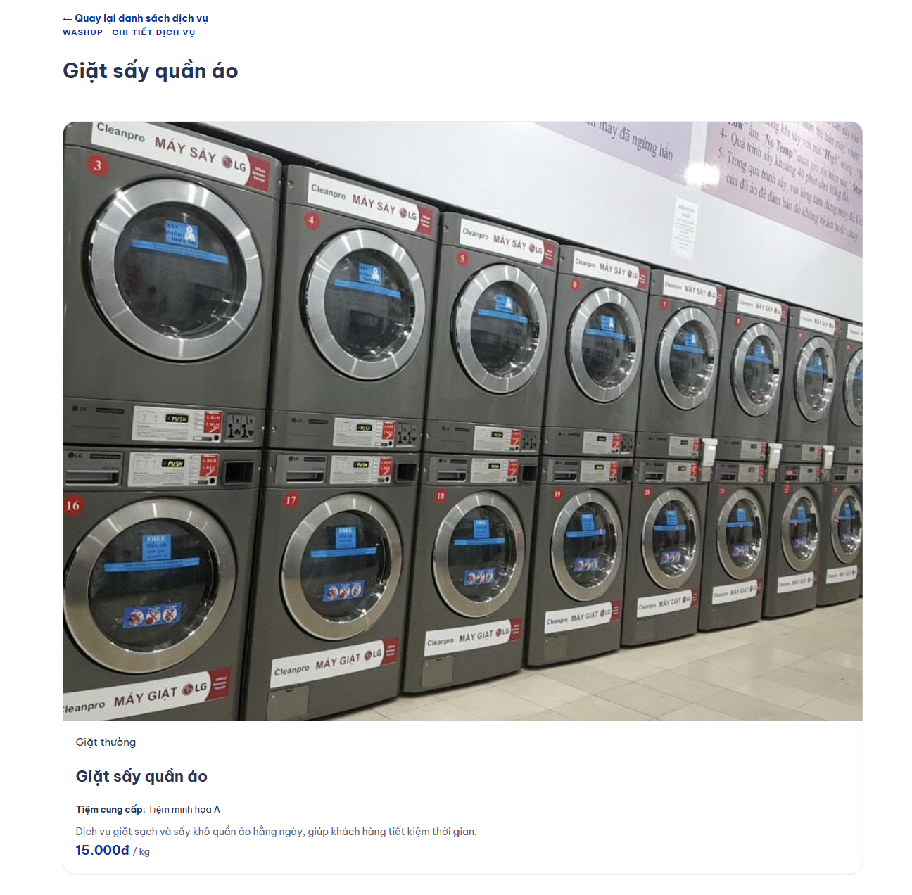

**Hình. Giao diện thông tin chi tiết dịch vụ WASHUP tại chiều rộng 1366px**

*Nguồn: Nhóm tác giả*

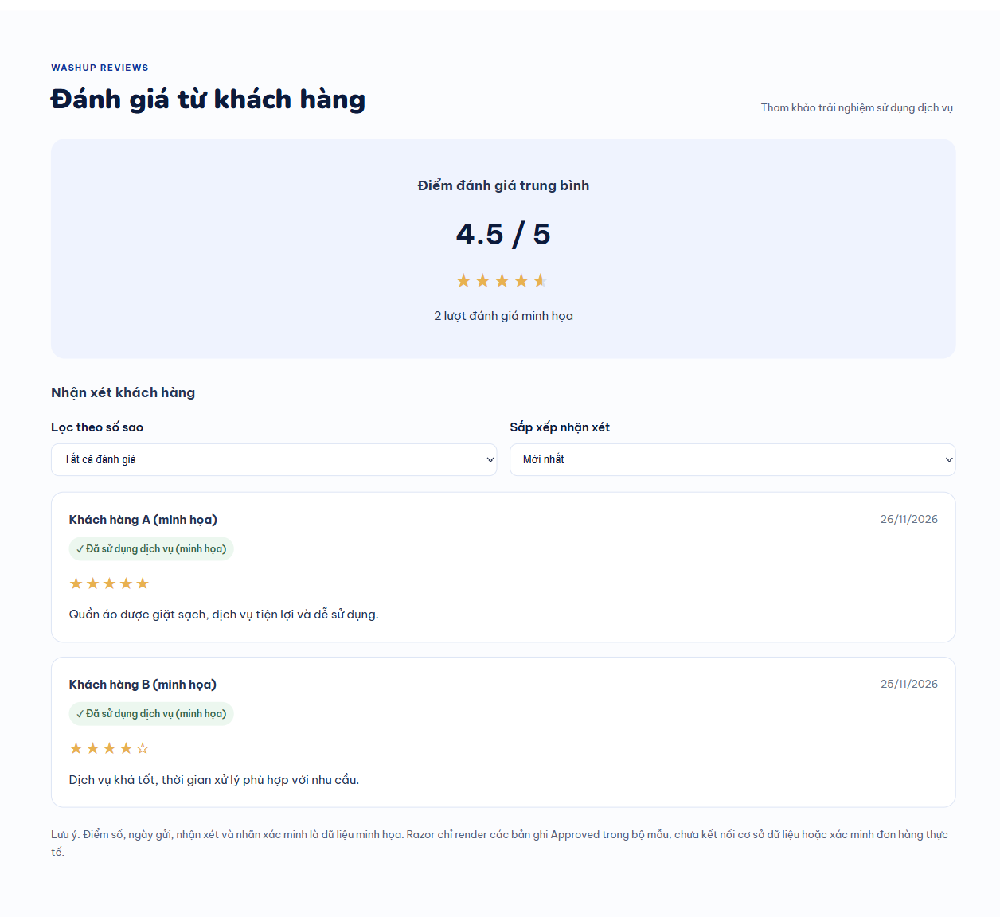

**Hình. Giao diện hiển thị và tra cứu nhận xét khách hàng tại chiều rộng 1366px**

*Nguồn: Nhóm tác giả*

Bên dưới danh sách nhận xét, biểu mẫu gửi đánh giá được tích hợp thông qua Partial View `_ReviewForm.cshtml`. Biểu mẫu bao gồm khu vực lựa chọn số sao, ô nhập nội dung, trường đính kèm hình ảnh và nút gửi đánh giá.

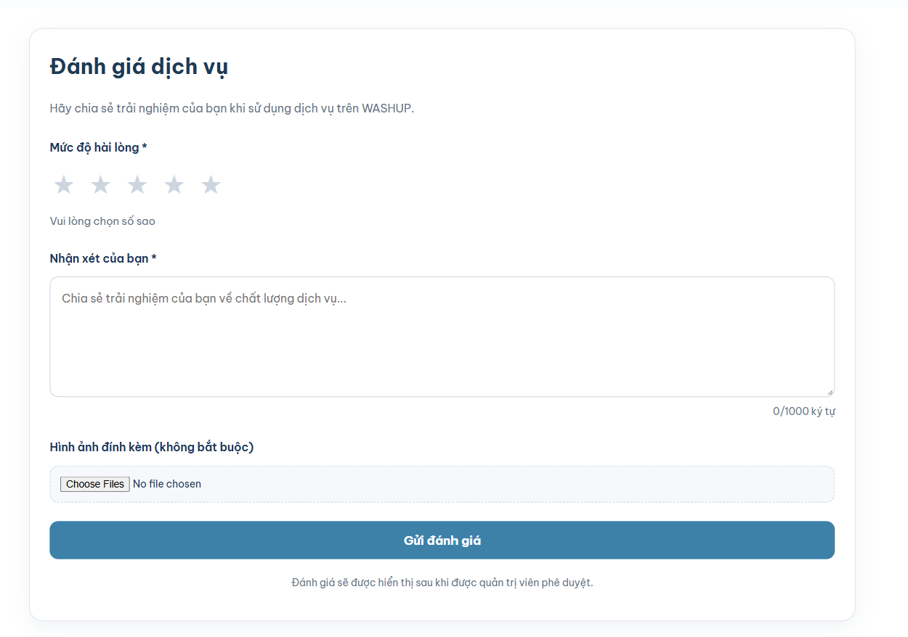

**Hình. Giao diện biểu mẫu gửi đánh giá dịch vụ WASHUP tại chiều rộng 1366px**

*Nguồn: Nhóm tác giả*

Tiêu chí kiểm tra tại kích thước này là các thành phần được bố trí cân đối, nội dung nhận xét hiển thị đầy đủ và người dùng có thể thao tác với bộ lọc, chức năng sắp xếp cũng như biểu mẫu gửi đánh giá.

### 4.9.3.2. Kiểm tra trên màn hình máy tính bảng 768px

Khi chiều rộng màn hình giảm xuống 768px, nhóm kiểm tra khả năng thích ứng của trang chi tiết dịch vụ trong điều kiện không gian hiển thị bị thu hẹp.

Đối với khu vực đánh giá, bộ lọc số sao và chức năng sắp xếp vẫn duy trì bố cục hai cột theo quy tắc CSS đã thiết lập. Các thẻ nhận xét được sắp xếp theo chiều dọc, trong đó thông tin khách hàng, ngày đánh giá và nhãn xác minh có khả năng điều chỉnh vị trí phù hợp với chiều rộng vùng chứa.

Điểm trung bình và tổng số lượt đánh giá vẫn sử dụng cùng bộ dữ liệu minh họa như trên màn hình máy tính.

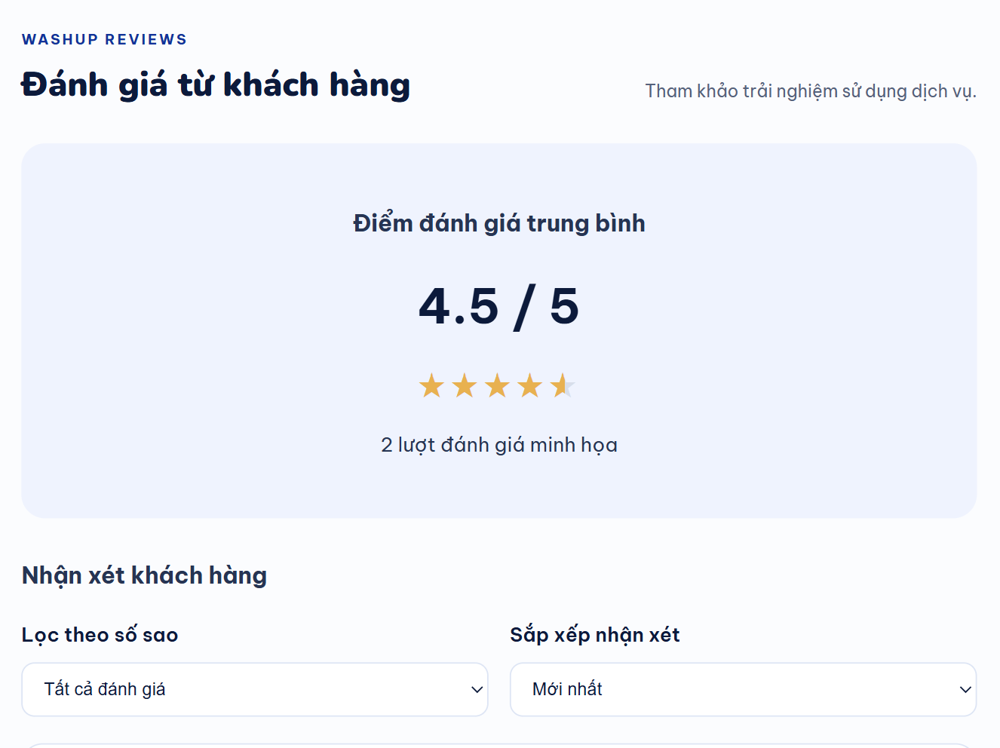

**Hình. Giao diện điểm đánh giá trung bình, bộ lọc và chức năng sắp xếp tại chiều rộng 768px**

*Nguồn: Nhóm tác giả*

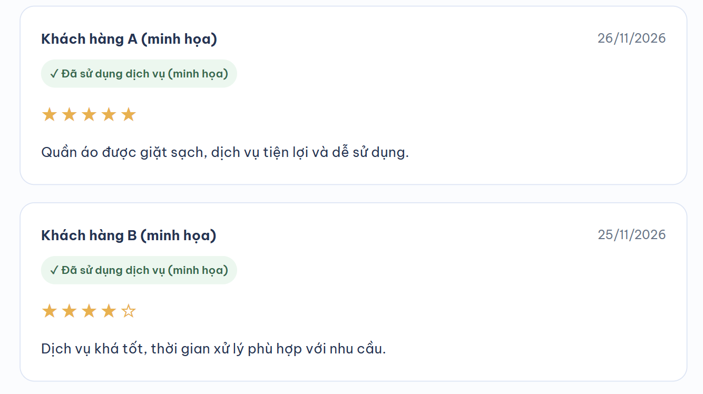

**Hình. Khả năng hiển thị thông tin khách hàng và nội dung nhận xét tại chiều rộng 768px**

*Nguồn: Nhóm tác giả*

Đối với biểu mẫu gửi đánh giá, nhóm kiểm tra khả năng hiển thị các trường nhập liệu, khu vực lựa chọn số sao, trường đính kèm hình ảnh và nút gửi.

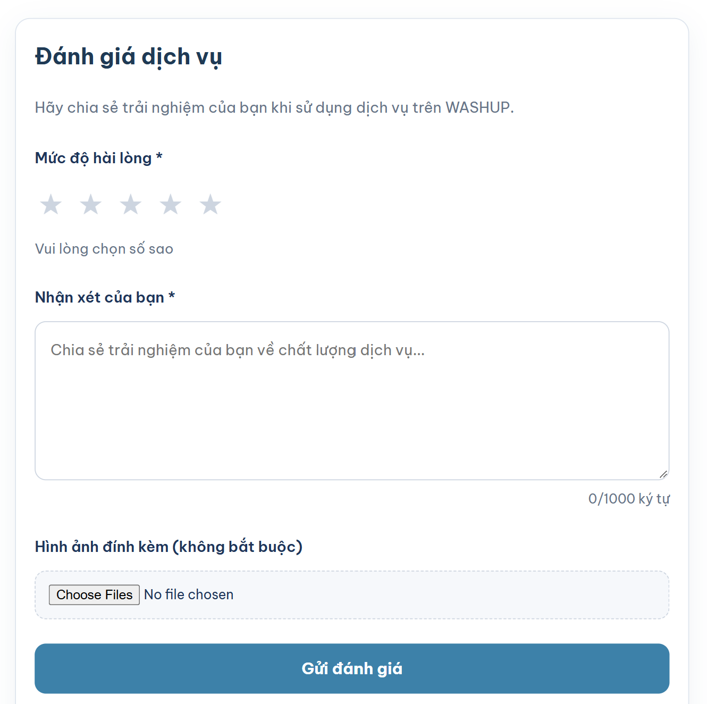

**Hình. Giao diện biểu mẫu gửi đánh giá trên màn hình máy tính bảng có chiều rộng 768px**

*Nguồn: Nhóm tác giả*

Tiêu chí kiểm tra tại kích thước 768px là duy trì khả năng đọc nội dung, hạn chế tình trạng chồng lấn giữa các thành phần và bảo đảm những chức năng tương tác có đủ không gian hiển thị.

### 4.9.3.3. Kiểm tra trên màn hình điện thoại 390px

Tại chiều rộng 390px, giao diện trang chi tiết dịch vụ được kiểm tra trong điều kiện không gian màn hình nhỏ. Các thành phần đánh giá được thiết kế theo hướng ưu tiên hiển thị nội dung từ trên xuống dưới.

Khung điểm trung bình được điều chỉnh kích thước chữ và khoảng cách bên trong. Bộ lọc số sao và chức năng sắp xếp chuyển từ hai cột sang một cột, giúp mỗi ô lựa chọn có đủ chiều rộng và thuận tiện hơn khi thao tác.

**Hình. Kết quả điều chỉnh bố cục bộ lọc và chức năng sắp xếp nhận xét trên điện thoại**

*Nguồn: Nhóm tác giả*

Đối với danh sách nhận xét, các thẻ được giảm khoảng cách bên trong nhằm tận dụng không gian hiển thị. Thông tin tên khách hàng, ngày gửi, nhãn xác minh và nội dung nhận xét được kiểm tra về khả năng tự xuống dòng trên màn hình hẹp.

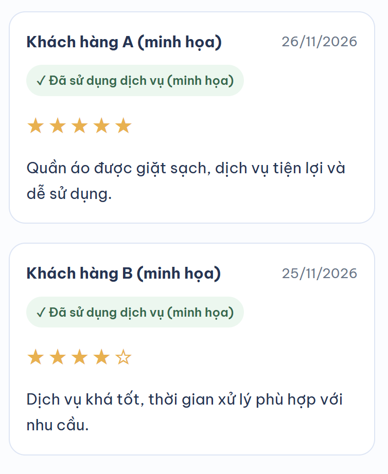

**Hình. Giao diện danh sách nhận xét khách hàng WASHUP tại chiều rộng 390px**

*Nguồn: Nhóm tác giả*

Nhóm tiếp tục kiểm tra biểu mẫu gửi đánh giá, tập trung vào khả năng lựa chọn số sao, nhập nội dung nhận xét, đính kèm hình ảnh và sử dụng nút gửi trên thiết bị di động.

**Hình. Giao diện biểu mẫu gửi đánh giá dịch vụ trên màn hình điện thoại**

*Nguồn: Nhóm tác giả*

Việc điều chỉnh bố cục theo chiều dọc hướng đến mục tiêu giúp khách hàng có thể tham khảo nhận xét và thực hiện các thao tác đánh giá mà không cần phóng to giao diện hoặc cuộn ngang màn hình.

## 4.9.4. Kiểm tra giao diện Dashboard thống kê đánh giá

### 4.9.4.1. Kiểm tra trên màn hình máy tính 1366px

Trên màn hình máy tính có chiều rộng 1366px, Dashboard được thiết kế theo bố cục nhiều cột nhằm tận dụng không gian để trình bày đồng thời nhiều nhóm thông tin thống kê.

Khu vực banner được chia thành hai phần, gồm thông điệp giới thiệu và khung hiển thị điểm trung bình. Trong phiên bản Dashboard cải tiến, bộ dữ liệu minh họa gồm 12 bản ghi, trong đó có tám đánh giá Approved với điểm trung bình 3,25/5.

Bộ lọc thống kê gồm tiệm giặt, dịch vụ, ngày bắt đầu và ngày kết thúc được bố trí trên cùng một hàng. Hai nút Áp dụng và Đặt lại được đặt bên dưới để hỗ trợ người quản trị điều chỉnh phạm vi phân tích.

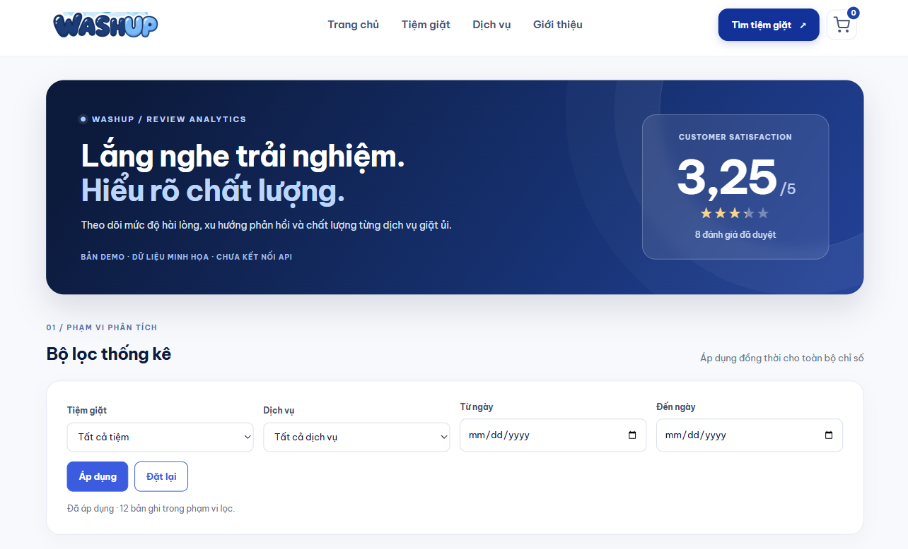

**Hình. Giao diện tổng quan và bộ lọc thống kê của Dashboard WASHUP tại chiều rộng 1366px**

*Nguồn: Nhóm tác giả*

Khu vực chỉ số nổi bật gồm bốn thẻ KPI được bố trí trên cùng một hàng. Các thẻ thể hiện số đánh giá đã duyệt, điểm trung bình, số đánh giá thấp từ 1 đến 2 sao và số dịch vụ có đánh giá Approved.

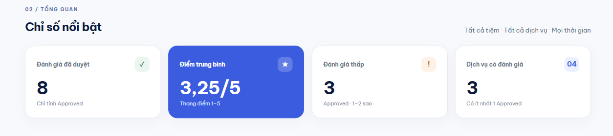

**Hình. Giao diện hiển thị các chỉ số KPI trên màn hình máy tính**

*Nguồn: Nhóm tác giả*

Đối với khu vực phân tích chất lượng dịch vụ, biểu đồ phân bố số sao và biểu đồ xu hướng theo thời gian được bố trí cạnh nhau. Cách tổ chức này giúp người quản trị quan sát đồng thời sự phân bố mức độ hài lòng và sự thay đổi của điểm trung bình theo ngày.

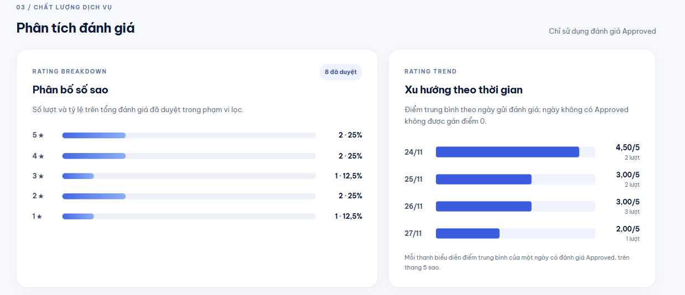

**Hình. Bố cục biểu đồ phân bố số sao và xu hướng đánh giá tại chiều rộng 1366px**

*Nguồn: Nhóm tác giả*

Khu vực xếp hạng dịch vụ và danh sách dịch vụ có đánh giá thấp cũng được bố trí cạnh nhau. Các thông tin về tên dịch vụ, tiệm giặt, điểm trung bình, tổng số lượt đánh giá và tỷ lệ đánh giá thấp được trình bày trong từng khối riêng biệt.

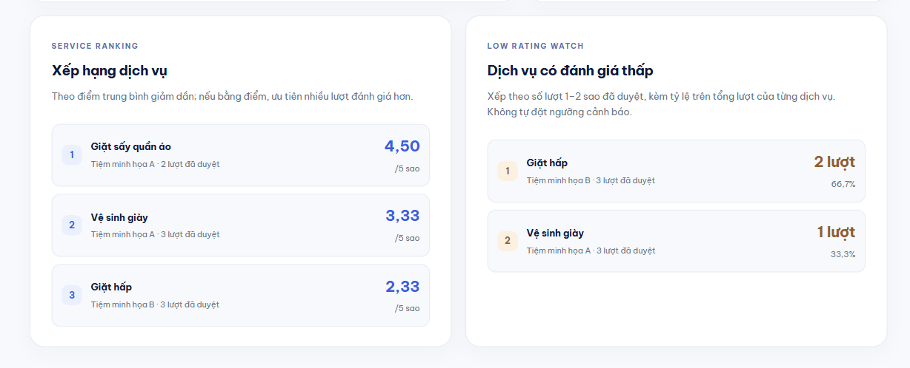

**Hình. Giao diện xếp hạng dịch vụ và thống kê phản hồi tiêu cực tại chiều rộng 1366px**

*Nguồn: Nhóm tác giả*

Cuối Dashboard là biểu đồ trạng thái kiểm duyệt, thể hiện sự phân bố của bốn trạng thái Approved, Pending, Rejected và Hidden. Biểu đồ vòng được bố trí kết hợp với phần chú thích nhằm hỗ trợ việc đọc và đối chiếu số liệu.

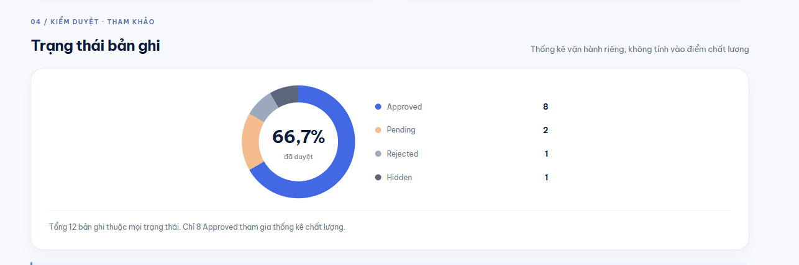

**Hình. Giao diện biểu đồ trạng thái kiểm duyệt đánh giá trên màn hình máy tính**

*Nguồn: Nhóm tác giả*

Tiêu chí kiểm tra trên màn hình máy tính là các nhóm thống kê được bố trí cân đối, nhãn biểu đồ và số liệu có đủ không gian hiển thị, đồng thời bộ lọc có thể được sử dụng thuận tiện.

### 4.9.4.2. Kiểm tra trên màn hình máy tính bảng 768px

Khi chiều rộng màn hình giảm xuống 768px, Dashboard được điều chỉnh từ bố cục nhiều cột sang bố cục hai cột hoặc một cột tùy theo từng thành phần.

Khu vực banner chuyển sang hiển thị nội dung giới thiệu và khung điểm trung bình theo chiều dọc. Việc thay đổi bố cục giúp hạn chế tình trạng tiêu đề và khung điểm số cạnh tranh không gian hiển thị.

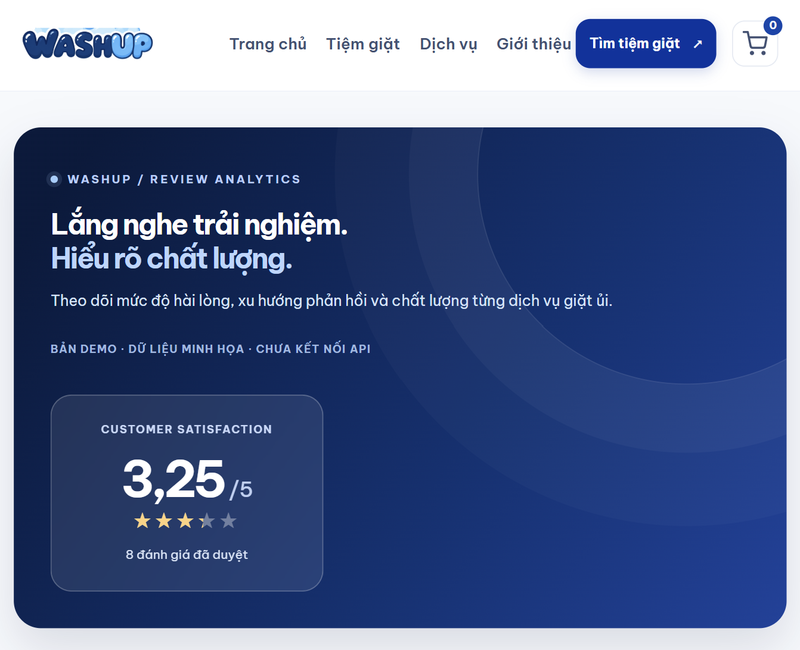

**Hình. Bố cục banner và khung điểm đánh giá trung bình tại chiều rộng 768px**

*Nguồn: Nhóm tác giả*

Đối với khu vực bộ lọc, bốn trường thông tin được chuyển thành hai cột và hai hàng. Các ô lựa chọn tiệm giặt, dịch vụ và khoảng thời gian được mở rộng trong phạm vi từng cột.

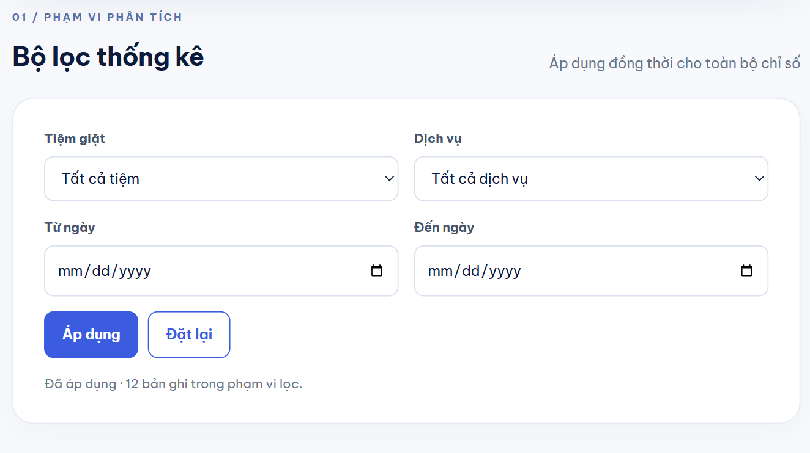

**Hình. Kết quả điều chỉnh bố cục bộ lọc thống kê trên màn hình máy tính bảng**

*Nguồn: Nhóm tác giả*

Bốn thẻ KPI cũng chuyển từ bố cục bốn cột sang hai cột và hai hàng. Cách bố trí này giúp duy trì không gian hiển thị cho tiêu đề, số liệu và phần mô tả của từng chỉ số.

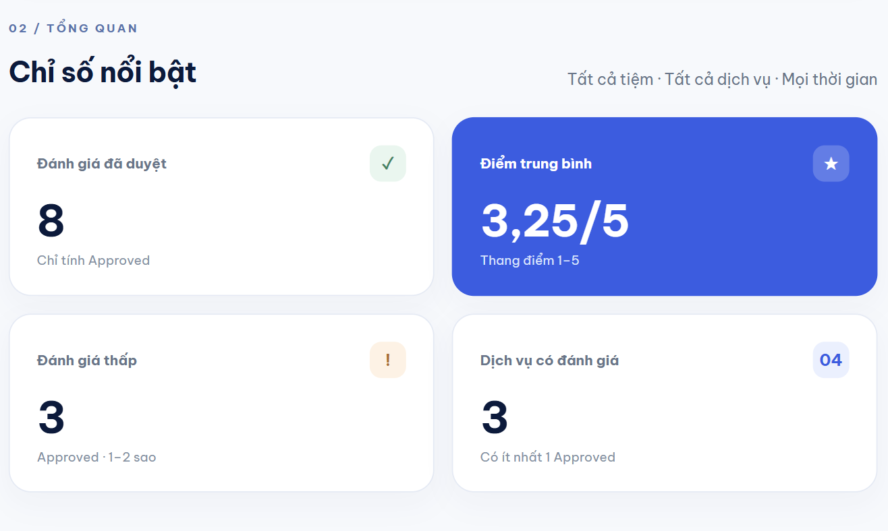

**Hình. Bố cục các thẻ KPI được điều chỉnh thành hai cột và hai hàng tại chiều rộng 768px**

*Nguồn: Nhóm tác giả*

Đối với khu vực biểu đồ, nhóm thiết lập bố cục một cột để từng nhóm thống kê có thể sử dụng phần lớn chiều rộng vùng nội dung.

Biểu đồ phân bố số sao được trình bày dưới dạng các thanh ngang, kết hợp nhãn số sao, số lượng và tỷ lệ tương ứng.

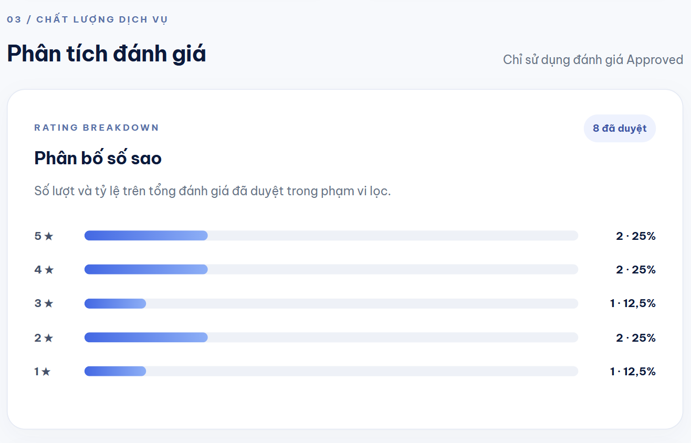

**Hình. Khả năng hiển thị biểu đồ phân bố số sao tại chiều rộng 768px**

*Nguồn: Nhóm tác giả*

Biểu đồ xu hướng đánh giá theo thời gian được chuyển xuống khu vực riêng bên dưới. Nhóm kiểm tra khả năng hiển thị ngày đánh giá, thanh biểu diễn, điểm trung bình và số lượt đánh giá của từng ngày.

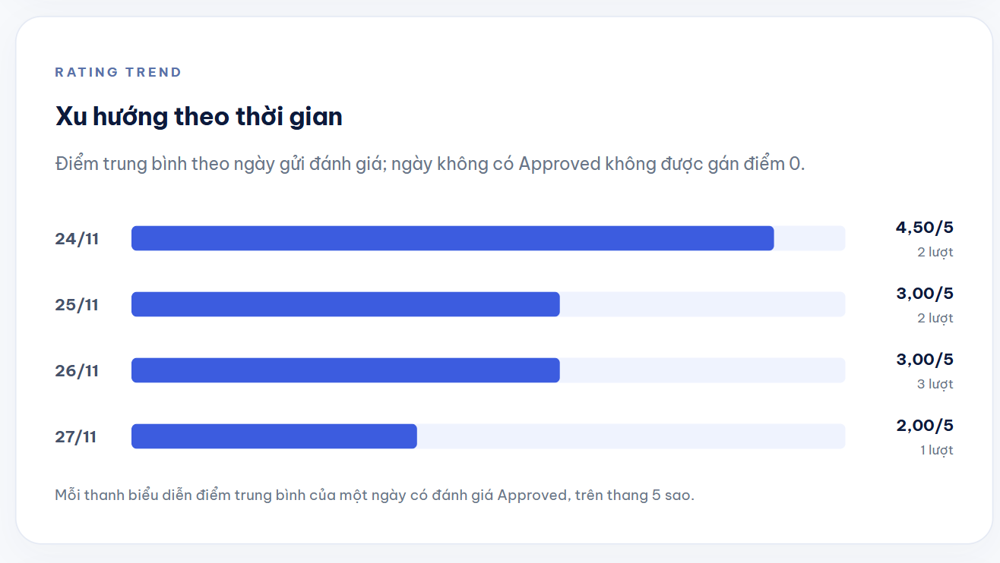

**Hình. Khả năng hiển thị biểu đồ xu hướng đánh giá theo thời gian trên màn hình máy tính bảng**

*Nguồn: Nhóm tác giả*

Khu vực xếp hạng dịch vụ và danh sách dịch vụ có đánh giá thấp được sắp xếp lần lượt theo chiều dọc. Cách điều chỉnh này giúp từng dịch vụ có đủ không gian để trình bày thông tin và số liệu thống kê.

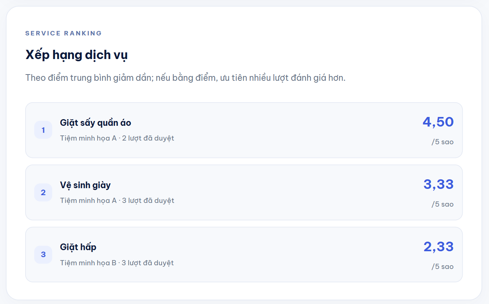

**Hình. Giao diện xếp hạng dịch vụ tại chiều rộng 768px**

*Nguồn: Nhóm tác giả*

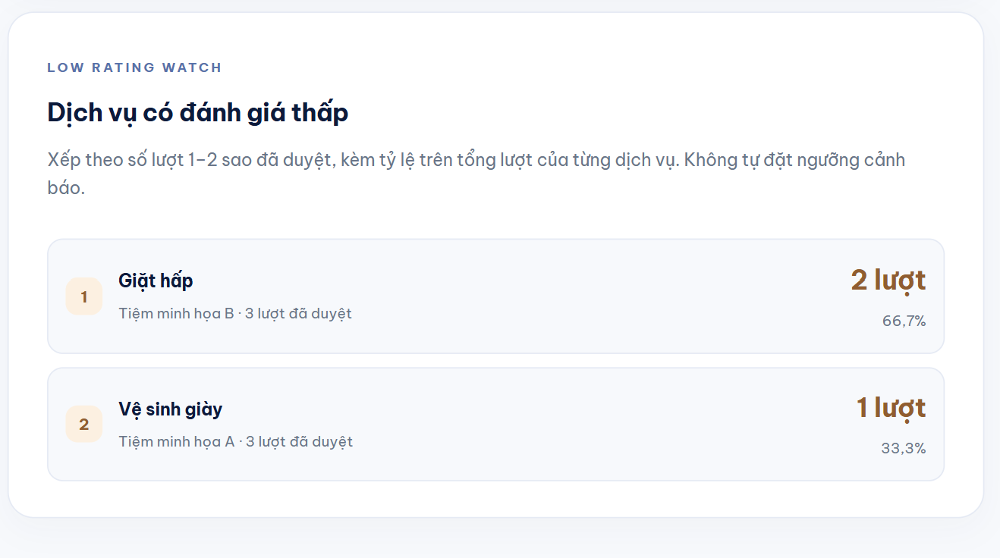

**Hình. Giao diện thống kê dịch vụ có đánh giá thấp tại chiều rộng 768px**

*Nguồn: Nhóm tác giả*

Đối với biểu đồ trạng thái kiểm duyệt, nhóm duy trì cách bố trí biểu đồ vòng và phần chú thích cạnh nhau nhằm tận dụng không gian còn lại trên màn hình máy tính bảng.

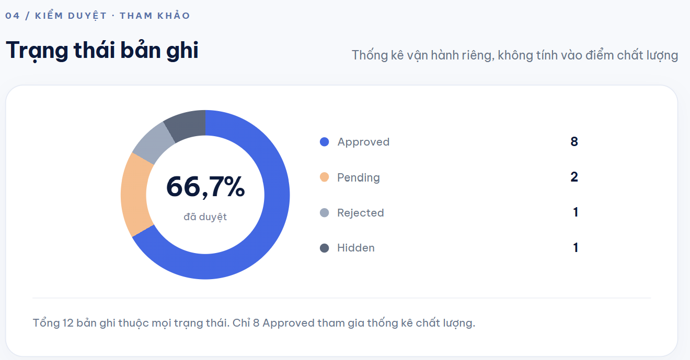

**Hình. Giao diện biểu đồ trạng thái kiểm duyệt tại chiều rộng 768px**

*Nguồn: Nhóm tác giả*

Tiêu chí kiểm tra tại kích thước này là các nhóm nội dung chuyển cột đúng quy tắc thiết kế, các số liệu không bị cắt mất và những thành phần tương tác vẫn có thể sử dụng thuận tiện.

### 4.9.4.3. Kiểm tra trên màn hình điện thoại 390px

Tại chiều rộng 390px, Dashboard được thiết kế theo hướng ưu tiên trình bày nội dung theo chiều dọc. Các thành phần giao diện được điều chỉnh về kích thước chữ, khoảng cách và vùng đệm để phù hợp với không gian màn hình nhỏ.

Khu vực banner duy trì bố cục một cột, trong đó khung điểm đánh giá trung bình được đặt bên dưới nội dung giới thiệu.

**Hình. Giao diện banner và điểm đánh giá trung bình của Dashboard trên điện thoại**

*Nguồn: Nhóm tác giả*

Bộ lọc thống kê chuyển hoàn toàn sang bố cục một cột. Các trường lựa chọn tiệm giặt, dịch vụ, ngày bắt đầu và ngày kết thúc được sắp xếp lần lượt từ trên xuống dưới nhằm hỗ trợ thao tác trên màn hình cảm ứng.

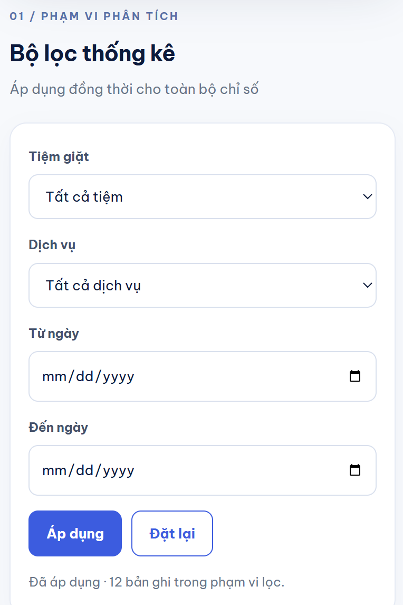

**Hình. Giao diện bộ lọc thống kê được điều chỉnh theo bố cục một cột trên điện thoại**

*Nguồn: Nhóm tác giả*

Bốn thẻ KPI duy trì bố cục hai cột và hai hàng, đồng thời giảm khoảng cách và điều chỉnh kích thước chữ để phù hợp với chiều rộng màn hình.

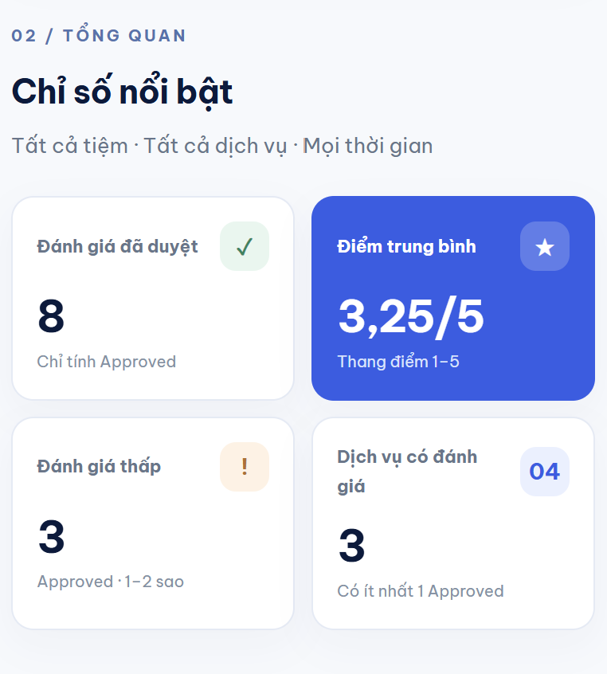

**Hình. Khả năng hiển thị các chỉ số KPI trên màn hình điện thoại có chiều rộng 390px**

*Nguồn: Nhóm tác giả*

Biểu đồ phân bố số sao và biểu đồ xu hướng theo thời gian được trình bày thành những khu vực riêng biệt theo chiều dọc. Khoảng cách giữa các nhãn, thanh biểu diễn và số liệu được thu gọn nhằm hạn chế tình trạng tràn khỏi vùng chứa.

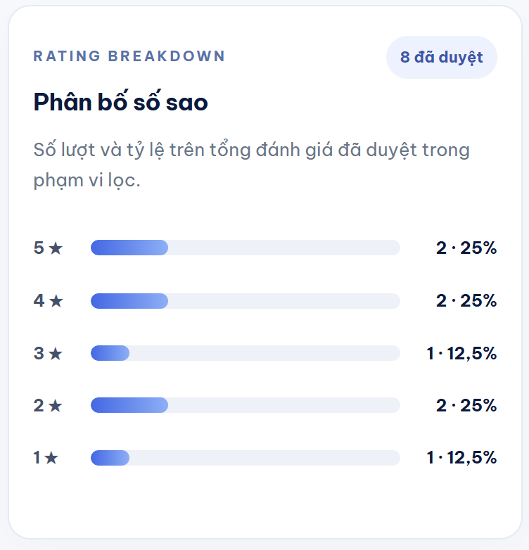

**Hình. Giao diện biểu đồ phân bố số sao trên thiết bị di động**

*Nguồn: Nhóm tác giả*

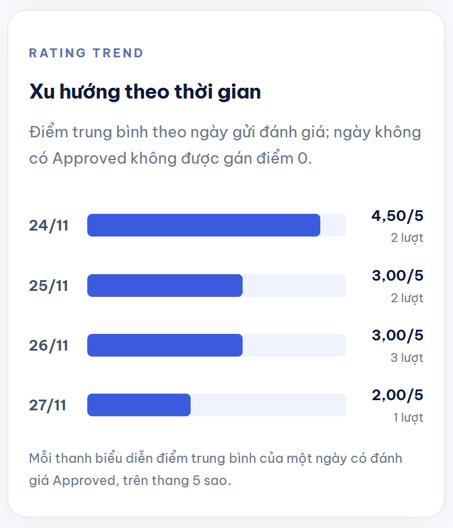

**Hình. Giao diện biểu đồ xu hướng đánh giá theo thời gian trên thiết bị di động**

*Nguồn: Nhóm tác giả*

Đối với khu vực xếp hạng dịch vụ, nhóm điều chỉnh kích thước và khoảng cách giữa các thành phần. Tên dịch vụ và tên tiệm giặt có khả năng tự xuống dòng, trong khi điểm trung bình và số lượt đánh giá được giữ trong vùng hiển thị tương ứng.

Danh sách dịch vụ có đánh giá thấp cũng được tổ chức thành các thẻ thông tin nhằm giúp người quản trị theo dõi từng dịch vụ mà không cần sử dụng bảng có nhiều cột trên màn hình nhỏ.

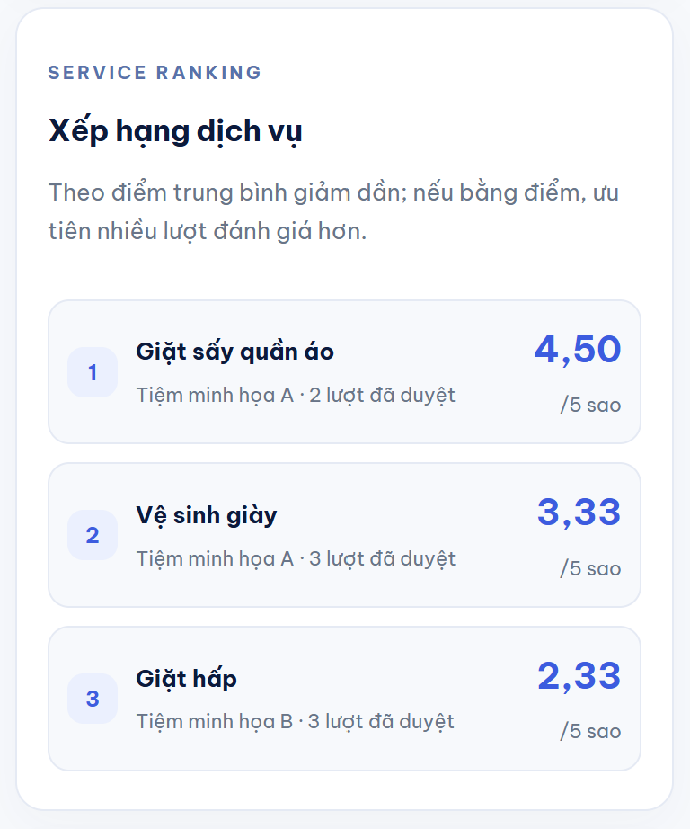

**Hình. Giao diện xếp hạng dịch vụ trên màn hình điện thoại**

*Nguồn: Nhóm tác giả*

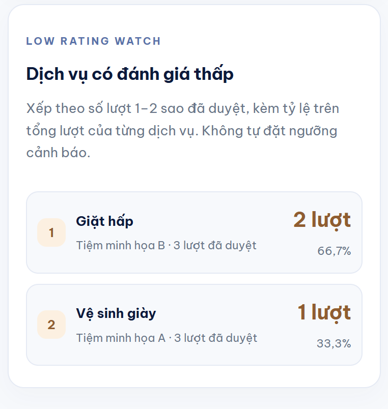

**Hình. Giao diện thống kê các dịch vụ có đánh giá thấp trên màn hình điện thoại**

*Nguồn: Nhóm tác giả*

Đối với biểu đồ trạng thái kiểm duyệt, nhóm điều chỉnh kích thước biểu đồ vòng và chuyển phần chú thích xuống phía dưới. Cách bố trí này giúp biểu đồ và các nhãn trạng thái không phải chia sẻ không gian theo chiều ngang như trên màn hình máy tính.

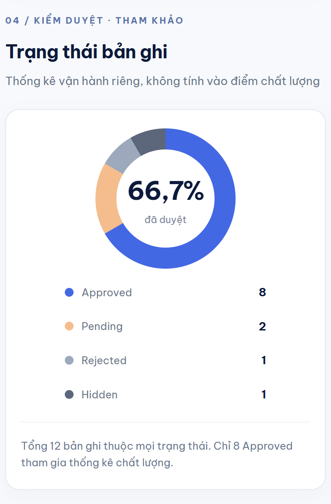

**Hình. Bố cục biểu đồ trạng thái kiểm duyệt được điều chỉnh theo chiều dọc tại 390px**

*Nguồn: Nhóm tác giả*

Tiêu chí kiểm tra tại chiều rộng 390px là duy trì khả năng đọc các chỉ số, thao tác với bộ lọc và theo dõi đầy đủ những nhóm thông tin thống kê mà không phát sinh hiện tượng tràn ngang hoặc chồng lấn nội dung.

## 4.9.5. Kiểm tra khả năng tương tác trên các thiết bị

Bên cạnh việc kiểm tra bố cục, nhóm xây dựng các trường hợp kiểm thử tương tác nhằm xác định khả năng hoạt động của các thành phần giao diện khi thay đổi kích thước màn hình.

Đối với trang chi tiết dịch vụ, các thao tác kiểm tra gồm lựa chọn bộ lọc số sao, thay đổi thứ tự sắp xếp, kiểm tra điểm trung bình và tương tác với biểu mẫu gửi đánh giá.

Đối với Dashboard, nhóm kiểm tra khả năng lựa chọn tiệm giặt, dịch vụ, khoảng thời gian, áp dụng bộ lọc và khôi phục dữ liệu ban đầu.

**Bảng. Các trường hợp kiểm thử tương tác trên giao diện responsive WASHUP**

| Mã kiểm thử | Giao diện | Nội dung kiểm thử | Kết quả mong đợi |
|---|---|---|---|
| RP01 | Trang chi tiết | Lọc đánh giá 4 sao | Chỉ hiển thị nhận xét của khách hàng B |
| RP02 | Trang chi tiết | Sắp xếp cũ nhất | Khách hàng B đứng trước khách hàng A |
| RP03 | Trang chi tiết | Lọc đánh giá 2 sao | Hiển thị thông báo không có đánh giá phù hợp |
| RP04 | Trang chi tiết | Thay đổi bộ lọc | Điểm trung bình vẫn giữ ở mức 4,5/5 |
| RP05 | Trang chi tiết | Thao tác với biểu mẫu | Có thể chọn sao, nhập nhận xét và chọn tệp ảnh |
| RP06 | Dashboard | Lọc dịch vụ Giặt sấy quần áo | Hiển thị hai Approved và điểm trung bình 4,50/5 |
| RP07 | Dashboard | Nhấn nút Đặt lại | Khôi phục tám Approved và điểm trung bình 3,25/5 |
| RP08 | Dashboard | Lọc khoảng thời gian không có dữ liệu | Hiển thị trạng thái không có dữ liệu |
| RP09 | Dashboard | Nhập khoảng thời gian không hợp lệ | Hiển thị thông báo lỗi |
| RP10 | Cả hai giao diện | Thay đổi chiều rộng màn hình | Bố cục được điều chỉnh, không làm thay đổi dữ liệu thống kê |

*Nguồn: Nhóm tác giả*

Các trường hợp trên được sử dụng để kiểm thử tại ba mức chiều rộng nhằm đối chiếu sự nhất quán giữa khả năng hiển thị và hoạt động của các chức năng.

Việc kiểm tra tương tác giúp nhóm đánh giá responsive không chỉ dựa trên hình thức trình bày mà còn dựa trên khả năng sử dụng thực tế của các thành phần giao diện.

## 4.9.6. Tổng hợp kết quả và đánh giá

### 4.9.6.1. Tổng hợp khả năng đáp ứng bố cục responsive

Thông qua các quy tắc CSS đã triển khai, nhóm xây dựng bố cục tương ứng với từng nhóm thiết bị. Trên màn hình máy tính, giao diện tận dụng không gian rộng để hiển thị nhiều thành phần cùng lúc. Trên máy tính bảng, các khu vực chính được điều chỉnh thành hai cột hoặc một cột. Đối với điện thoại, giao diện ưu tiên sắp xếp nội dung theo chiều dọc.

**Bảng. Tổng hợp khả năng điều chỉnh bố cục của hệ thống đánh giá WASHUP**

| Tiêu chí | 1366px | 768px | 390px |
|---|---|---|---|
| Điểm đánh giá trung bình | Khung thông tin rộng | Điều chỉnh theo vùng chứa | Thu gọn kích thước |
| Bộ lọc và sắp xếp nhận xét | Hai cột | Hai cột | Một cột |
| Danh sách nhận xét | Thẻ thông tin theo chiều dọc | Điều chỉnh chiều rộng thẻ | Giảm khoảng cách, hỗ trợ xuống dòng |
| Biểu mẫu gửi đánh giá | Hiển thị đầy đủ trường nhập liệu | Điều chỉnh theo vùng chứa | Ưu tiên thao tác theo chiều dọc |
| Banner Dashboard | Hai cột | Một cột | Một cột, thu gọn kích thước |
| Bộ lọc Dashboard | Bốn cột | Hai cột | Một cột |
| Các thẻ KPI | Bốn cột | Hai cột | Hai cột, thu gọn khoảng cách |
| Biểu đồ phân bố sao và xu hướng | Hai khu vực cạnh nhau | Một cột | Một cột |
| Xếp hạng dịch vụ và đánh giá thấp | Hai khu vực cạnh nhau | Một cột | Một cột |
| Biểu đồ trạng thái kiểm duyệt | Biểu đồ và chú thích cạnh nhau | Biểu đồ và chú thích cạnh nhau | Chú thích nằm dưới biểu đồ |

*Nguồn: Nhóm tác giả*

Bảng tổng hợp thể hiện bố cục được thiết lập trong mã nguồn và là cơ sở đối chiếu với các ảnh minh chứng tại mục 4.9.3 và 4.9.4.

Kết quả kiểm tra cần bảo đảm việc thay đổi kích thước màn hình không làm thay đổi nguyên tắc hiển thị đánh giá Approved, kết quả tính điểm trung bình hoặc phạm vi thống kê đã lựa chọn.

### 4.9.6.2. Ưu điểm của phương án thiết kế

Việc sử dụng CSS Grid, Flexbox và media query giúp nhóm tổ chức giao diện linh hoạt mà không cần phát triển các phiên bản website riêng biệt cho từng thiết bị.

Các thành phần giao diện như thẻ nhận xét, bộ lọc, KPI và biểu đồ được thiết kế thành những khối độc lập, giúp việc thay đổi bố cục trở nên thuận tiện hơn.

Bên cạnh đó, việc tách riêng các tệp CSS và JavaScript của danh sách nhận xét và Dashboard giúp hạn chế ảnh hưởng đến những thành phần khác của hệ thống, đồng thời hỗ trợ quá trình bảo trì và tích hợp mã nguồn.

### 4.9.6.3. Hạn chế và hướng hoàn thiện

Trong phạm vi hiện tại, hoạt động kiểm tra responsive được thực hiện chủ yếu bằng công cụ mô phỏng thiết bị Chrome DevTools. Phương pháp này giúp nhóm kiểm tra nhiều kích thước màn hình nhưng chưa thay thế hoàn toàn việc kiểm thử trên các thiết bị vật lý và trình duyệt khác nhau.

Ngoài ra, trang chi tiết dịch vụ và Dashboard vẫn sử dụng dữ liệu minh họa. Vì vậy, kết quả kiểm tra phản ánh khả năng hiển thị và tương tác trong phạm vi dữ liệu thử nghiệm, chưa thể hiện đầy đủ những tình huống có số lượng đánh giá lớn hoặc nội dung nhận xét dài từ cơ sở dữ liệu.

Trong giai đoạn tích hợp tiếp theo, nhóm cần kiểm tra lại giao diện sau khi kết nối với các phân hệ xử lý đánh giá và API thống kê. Những trường hợp cần được bổ sung bao gồm dịch vụ chưa có đánh giá, dịch vụ có nhiều nhận xét, tên dịch vụ dài, dữ liệu thống kê có nhiều mốc thời gian và những tình huống thay đổi trạng thái kiểm duyệt.

Nhóm cũng cần tiếp tục rà soát khả năng hiển thị của Header, các thành phần điều hướng và những trường nhập liệu tại các kích thước màn hình trung gian nhằm nâng cao tính nhất quán của toàn bộ website.

Nhìn chung, phương án thiết kế responsive đã tạo cơ sở để hệ thống đánh giá WASHUP thích ứng với nhiều kích thước màn hình. Việc hoàn thiện kiểm thử trên dữ liệu thực tế sẽ giúp nâng cao khả năng sử dụng, tính ổn định và chất lượng trải nghiệm của khách hàng cũng như người quản trị.
